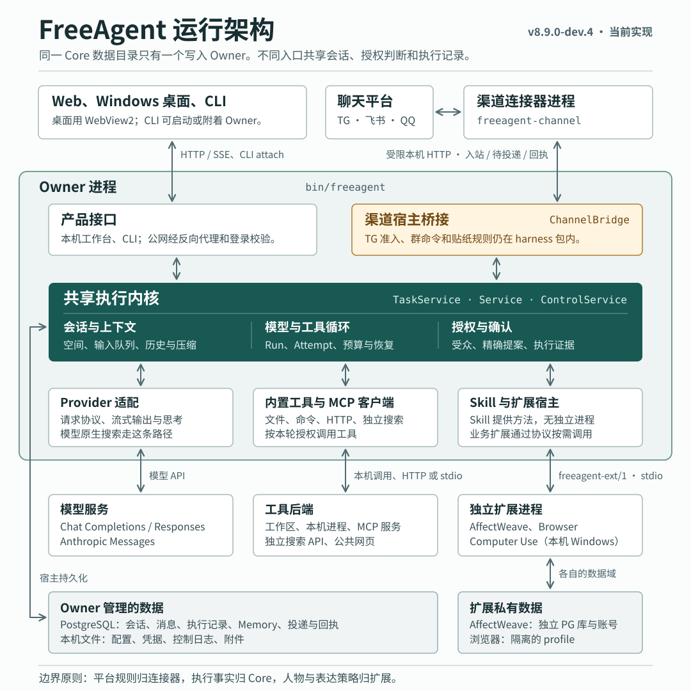
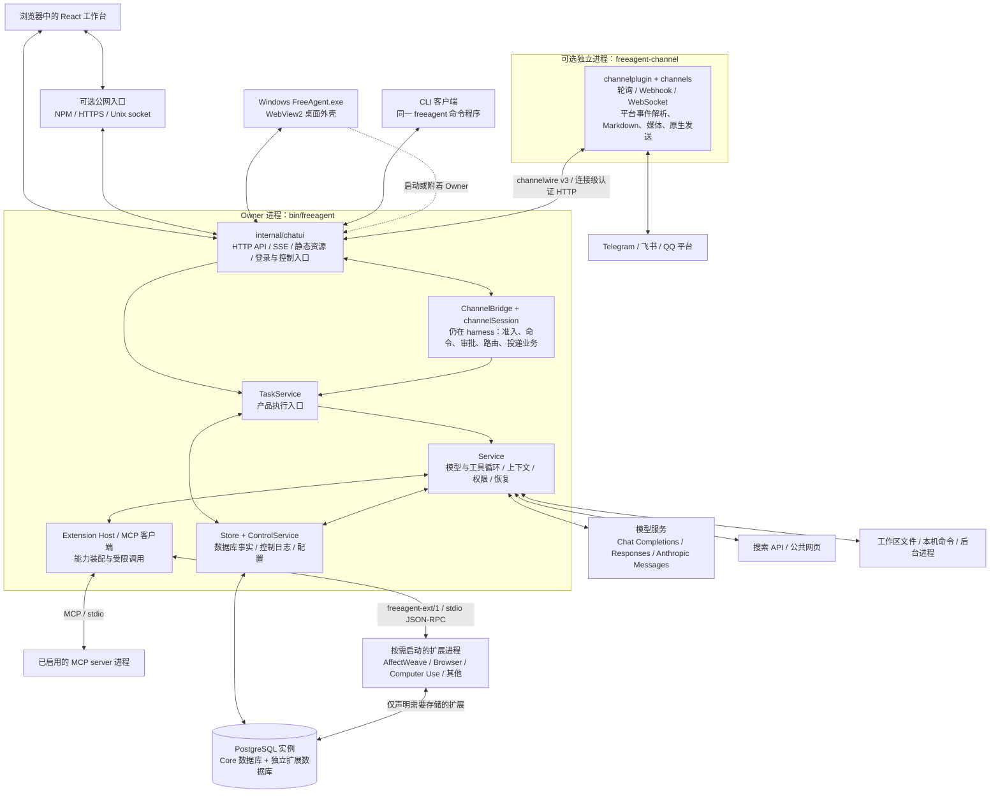
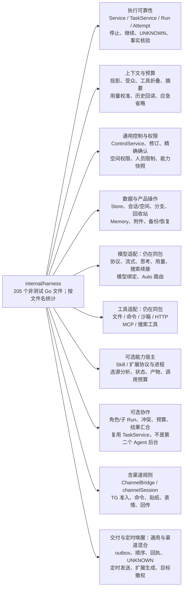
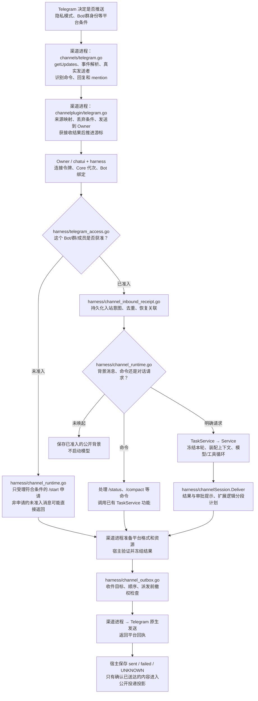
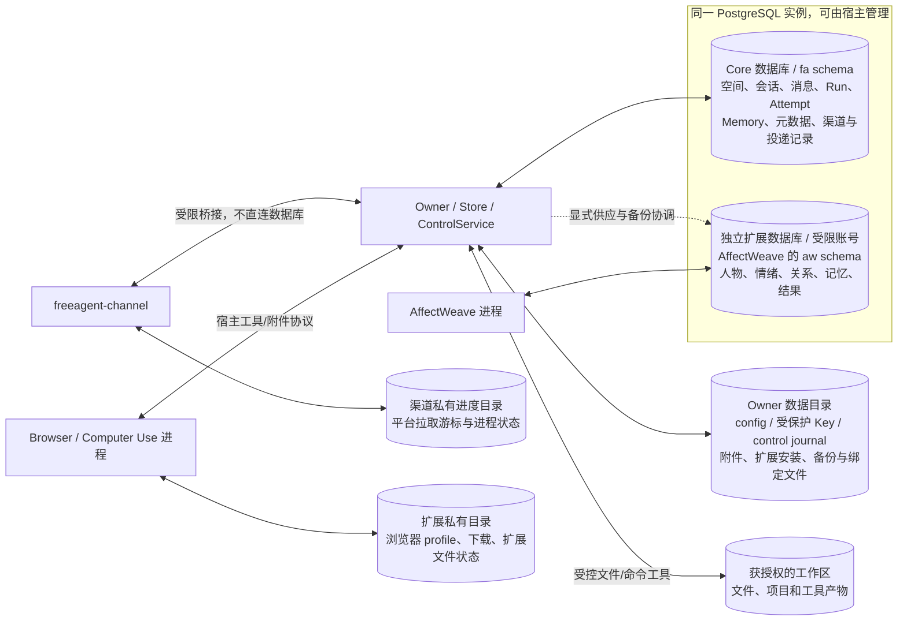
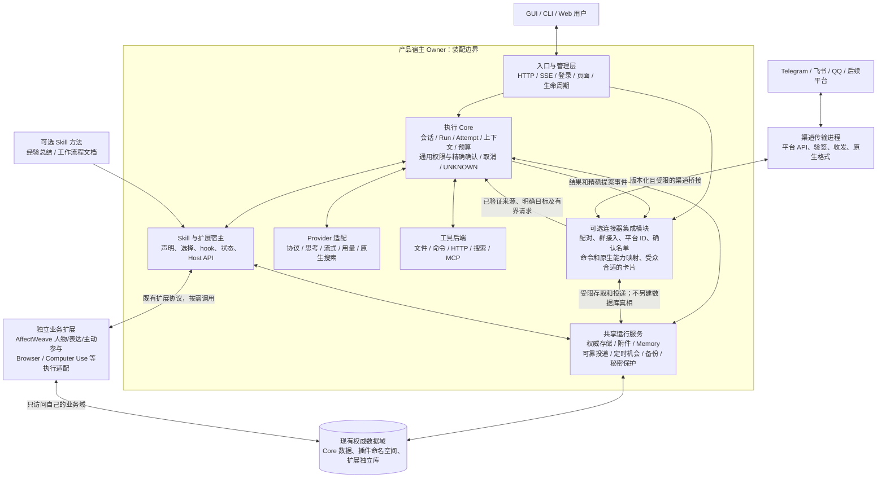

# FreeAgent 完整架构图与 Core 边界核查

日期：2026-11-19。代码基线：`v8.9.0-dev.4`，工作树 HEAD `80b1cb40cd4094cde0213a737dd2b28ddf059b03`。依据当前源码、Go 包依赖和现有协议；不是已实施的重构方案，也不代表本次重新验收了线上各项功能。

**当前 FreeAgent 已把平台收发拆成独立渠道进程，但宿主 `internal/harness` 仍同时承担执行内核、平台业务与多种运行时适配职责。进程拆分已经发生，职责拆分尚未完成。** 下文图 1–4 是现状，图 5 是建议边界，不能将目标图当作已有实现。



[查看高清 PNG](diagrams/freeagent-system-overview.png)。这张 2026-11-22 重绘的总图只画当前可运行的系统；橙框指出渠道接入层中仍与执行包耦合的业务规则。远程执行节点和多写入者集群均不属于当前实现。

## 1. 先分清四个名称

| 名称 | 本文中的含义 |
| --- | --- |
| FreeAgent 产品 | GUI、CLI、Web、执行内核、模型和工具适配、扩展宿主、可选渠道，以及发行/运维组合 |
| Owner | 同一数据目录的权威运行实例；持有写入/执行所有权，承载产品 HTTP API、流式事件及 TaskService。它是运行边界，不是某一个功能包 |
| `internal/harness` | 现在的大 Go 包，包含 `Service`、`TaskService`、`Store`，也包含 Provider、工具、渠道业务和扩展宿主。不能把包里每一行都认定为必须保留在最小 Core |
| Core（目标中的执行内核） | 会话/Run/Attempt、上下文、预算、通用权限与精确确认、调度执行、事实记录及恢复。它不拥有 Telegram 群规则、人物算法或平台格式 |

**Owner 内可以装配多个模块，多个模块也可以共用一个进程和 PostgreSQL 实例。** 从 Core 拆走渠道业务，不等于必须再增加一个服务、数据库或第二套 Agent。

## 2. 图 1：当前进程和系统组成

实线表示运行时调用/数据流；虚线表示按需启动、装配或辅助关系。框中的进程边界与源码包边界不是同一件事。



- Web 前端由 Go 嵌入静态资源提供；用户运行便携包不需要 Node。桌面是 WebView2 外壳，不是第二个 Agent。CLI 有附着、启动 Owner 及离线管理等路径，图中表现的是共享在线实例的主要路径。
- `freeagent-channel` 只在已配置渠道时使用。服务器可由独立 systemd unit 管理；交互启动器可以管理随 Owner 启停的渠道进程。一个 Bot 不能同时由两份轮询消费者运行。
- 浏览器/Computer Use 在 Owner 所在机器执行，不是远端网页访问者自己的浏览器或桌面。Computer Use 当前只支持本机 Windows 的明确授权路径。
- PostgreSQL 可由产品管理或连接既有实例。扩展需要独立业务数据时，复用实例、使用自己的数据库和受限凭据；并非所有扩展都需要数据库。

源码入口：[Owner 装配](../cmd/freeagent/owner.go)、[桌面](../cmd/freeagent-desktop/main_windows.go)、[渠道进程](../cmd/freeagent-channel/main.go)、[HTTP 服务](../internal/chatui/server.go)、[运行时装配](../internal/harness/runtime.go)。

## 3. 图 2：现在 `harness` 里面具体有什么

这是一张责任地图，不表示每个节点已经是独立 Go 包。两条“含渠道规则”分支是本次重点，Provider 等也仍与执行内核同包。



| 模块 | 真实入口 | 边界判断 |
| --- | --- | --- |
| 执行循环与事实 | [service.go](../internal/harness/service.go)、[taskservice.go](../internal/harness/taskservice.go)、[tool_outcome.go](../internal/harness/tool_outcome.go)、[unresolved.go](../internal/harness/unresolved.go) | 执行内核的基础职责，保持单一权威 |
| 上下文管理 | [context_projection.go](../internal/harness/context_projection.go)、[context_prepare.go](../internal/harness/context_prepare.go)、[context_recovery.go](../internal/harness/context_recovery.go)、[context_calibration.go](../internal/harness/context_calibration.go)、[context_tools.go](../internal/harness/context_tools.go) | 应统一保留。摘要失败、折叠、回读及协议配对不能交给渠道各自实现 |
| 控制与能力 | [control.go](../internal/harness/control.go)、[permissions.go](../internal/harness/permissions.go)、[capability_selection.go](../internal/harness/capability_selection.go) | 精确写入和执行授权通用；里面的具体平台操作和 ID 解释需要与通用部分区分 |
| 模型和工具后端 | [runtime.go](../internal/harness/runtime.go)、[openai.go](../internal/harness/openai.go)、[responses.go](../internal/harness/responses.go)、[provider_anthropic.go](../internal/harness/provider_anthropic.go)、[mcp.go](../internal/harness/mcp.go)、[command_service.go](../internal/harness/command_service.go) | 是必要适配能力，不必全部改成插件进程；适合与内核分包、通过小接口装配 |
| 搜索 | [web_search.go](../internal/harness/web_search.go)、[provider_web_search.go](../internal/harness/provider_web_search.go)、[internal/webaccess](../internal/webaccess) | 搜索服务 HTTP/正文适配已在独立包，当前仍由宿主编入；原生搜索属于 Provider 协议，不属于渠道 |
| Memory / Skill / 经验总结 | [memory.go](../internal/harness/memory.go)、[skills.go](../internal/harness/skills.go)、[source_analysis.go](../internal/harness/source_analysis.go)、[经验总结说明](EXPERIENCE_SUMMARY.md) | 通用资料存取和选源属于宿主；经验提炼的方法是可选 Skill，不是独立核心总结器 |
| 扩展与协作 | [extensions.go](../internal/harness/extensions.go)、[extension_state_contract.go](../internal/harness/extension_state_contract.go)、[collaboration.go](../internal/harness/collaboration.go) | 生命周期、范围、预算和事实协调属于宿主；人物算法和实际浏览器控制不在 Core 源码内 |
| 渠道与交付 | [channel_runtime.go](../internal/harness/channel_runtime.go)、[telegram_access.go](../internal/harness/telegram_access.go)、[channel_expression.go](../internal/harness/channel_expression.go)、[channel_outbox.go](../internal/harness/channel_outbox.go)、[scheduled_generation.go](../internal/harness/scheduled_generation.go) | 当前混有通用执行保证和平台/产品规则，需要拆开，不能整块搬走或整块认作 Core |

本次数到 `channel_*.go` 21 个、`telegram_*.go` 1 个，共 22 个；还没有计入 `Store`、权限、配置、控制操作和数据库 schema 内的渠道字段。**文件数只说明同包责任范围，不代表体积、性能开销或可直接删除的代码量。**

## 4. 图 3：一条群消息实际经过哪些地方

此图解释“没有回复”为什么不能只看模型日志，也标明群规则目前分散在哪。



关键边界：平台有没有推送，与 FreeAgent 要不要回复，是两个阶段。当前普通群文本的接收、准入返回、触发判定并没有统一的逐层诊断；“Core 没有普通消息记录”不能单独证明 Telegram 从未推送。也不能通过增加摘要预算来解决这类入站问题。

图中为主链，省略连接握手和部分错误分支；媒体、审批点击、主动消息各有自己的记录和校验。主动生成不是普通入站：已授权规则产生唤醒机会，扩展判断是否生成，宿主核对预算/来源/目标，仍经同一投递记录发送。

## 5. 图 4：数据到底归谁



- `fa.meta` 当前也存渠道准入、入站意图、outbox、摘要和各种功能元数据；不是每个概念都有一张独立表。控制提案还有 `control-journal.jsonl` 文件，因此不能把“所有状态都只在 PostgreSQL”画成现状。
- 核心 Key 和渠道 Key 使用独立文件/协议命名空间，但受保护的存储实现仍在 `harness/keys.go`，包含平台协议类型和官方来源判断。
- AffectWeave 的业务数据由独立程序直接读写自己的数据库，Core 通过状态协议和通用存储维护协调，不直接解释情绪表。经验总结 Skill 没有自己的数据库。浏览器等只需要自己的文件状态，不强制建 PG 库。
- 插件不直连 Core 数据库是协议与数据边界；本地原生扩展通常仍以同一 OS 用户运行，**独立进程不等于 OS 沙箱**。不能把图中的逻辑边界当作已具备完整恶意代码隔离。

数据依据：[Core schema](../internal/harness/postgres_schema.sql)、[Store](../internal/harness/store.go)、[扩展存储供应](../internal/postgres/extension.go)、[控制日志](../internal/harness/control.go)、[扩展协议](../extension-kit/SPEC.md)。

## 6. 已经拆开的与仍耦合的，逐项核对

| 位置 | 当前真实情况 | 是否应继续拆 |
| --- | --- | --- |
| `internal/channels`、`internal/channelplugin` | 平台 SDK/API、事件解析、网络连接、Markdown/entities、资源准备与真正的发送，编入独立渠道程序 | 已拆，保留；继续完善群接收条件和入站可观察性，不移回 Core |
| `harness/channel_runtime.go` | 解释 `/start`、`/mode`、`/new` 等渠道命令、群触发类型、审批投递与提示 | 平台命令/交互流程应归连接器集成模块；调用通用会话、取消、确认等 Core API |
| `harness/telegram_access.go` | TG 数字身份、群/私聊接入申请、成员列表、申请码和 Bot 修订 | 明确属于 TG 连接器业务，不应成为通用执行包的前置知识；Core 仍保留可信入口绑定与通用授权核对 |
| `harness/channel_sticker_*`、`channel_expression.go` | Telegram 贴纸包、资源引用有效期、表情/贴纸工具与发言限制 | 平台资源规则和工具说明归渠道模块；资源有界、精确目标、真实回执等执行保证保留通用实现 |
| `Config.Channels`、`Store.telegram*` | 通用 Config 引用带平台字段的连接结构，Store 直接持有 TG Bot/申请等运行态 | 需要解耦所有权；不能只移动文件。插件配置可仍用宿主受保护存储，但字段语义、验证和生命周期由所属模块负责 |
| `space_permissions.go`、`store.go`、`postgres_schema.sql` | 人员 ID 校验识别 `telegram:user:`/飞书/QQ 前缀；空间来源/schema 固定列举平台；权限路径会调用 TG 撤权核对 | 这是跨边界耦合，逐步替换为受信连接下的来源/范围引用和通用约束。无需新增 Core 用户中心、统一账号或角色层级 |
| `ControlOperationCatalog` 与 `keys.go` | 列有 TG 接入/贴纸包动作、平台凭据种类，和通用设置提案共用大实现 | 具体动作和平台校验归渠道集成；精确预览、修订、确认、秘密保护和执行日志继续复用宿主 |
| `channel_outbox`、`scheduled_*`、`delivery_policy.go` | 可靠投递、定时唤醒的通用规则与 `ChannelTarget`、TG 贴纸等平台概念混在一起 | 把通用投递保证提成可复用模块，具体载荷/目标解释留渠道；仍只有一份权威投递和恢复记录，不另起重发器 |
| 前端 `ChannelSettings` 与 `AffectWeavePage` | 产品本身包含平台/扩展管理页，并按需加载部分详情页 | 页面在产品 UI 可接受；宿主壳与可选页边界应清楚，不等于 Core 可以拥有平台/人物算法，也不需要动态任意脚本 UI 平台 |
| Provider / 工具 / 扩展宿主 / 协作 | 多个可分离的职责仍在同一个大包，但不同于平台专属业务 | 可以按维护成本逐步分包；不因追求“最小”把每个组件都进程化或搬进业务扩展 |

依赖检查本次实际通过：Windows 上运行 `scripts/check-core-boundaries.py`，确认 `cmd/freeagent`、`internal/harness` 的依赖中没有 `internal/channels`、`internal/channelplugin` 或 AffectWeave 实现；另外以 Linux 目标检查了依赖，主程序仍依赖 `harness`、`chatui`、`channelwire`、`webaccess`、`postgres`。

**现有检查只防止导入平台实现包，没有禁止宿主自己写 TG 业务。** 因而“无平台 SDK 依赖”与“Core 已与渠道业务解耦”不能互相替代。当前统计和检查是源码证据，不是新的性能或功能验收。

## 7. 图 5：建议的完整责任边界（未实现）

图中新增的是清楚的组件边界，不要求新增进程。仍由 Owner 装配，数据仍经既有权威存储提交。连接器的宿主侧集成可以与 Owner 同进程，但必须离开执行内核，并通过有限接口调用它。



### 7.1 三种权限分别归属

| 判断 | 归属 | 不能因此获得的权力 |
| --- | --- | --- |
| 平台事件是真是假；哪个账号、哪个群、谁点了按钮；该 Bot 允许哪些人接入/确认 | 对应连接器集成与平台适配器 | 不得直接改 Core 表、自报一个通用管理员标记，或把另一群的按钮当作本次确认 |
| 此请求能访问哪个空间；能调用什么工具；是否批准了这份精确改动；实际是否写入/发送 | Core 与共享的权威控制/投递服务 | `Full` 不自动变成管理者；确认名单也不自动允许代批别人的命令；消息接入不自动授予工具或主动发送 |
| 芋圆能用于哪些空间、人物资料和状态怎么变化、是否自然分段/何时想发言 | AffectWeave；其他扩展管自己的同类规则 | 扩展的候选、上下文或表达意图不是执行授权。Core 不因扩展 ID 特判权限 |

连接器可以保存/复用宿主授权记录，但通用 Core 只核对这次绑定的来源、目标、授权范围和决定。保留已有人员引用即可，不要求跨平台统一人、Core 超级管理员或新的通用 ACL。

### 7.2 两个“留在宿主”的部分不能一起搬空

1. 接收到用户请求后何时采用输入、创建/恢复哪个 Run，以及工具配对和上下文受众，仍由一份 Core 规则保证。连接器不能重新拼 prompt、压缩历史或建立另一套 Agent 队列。
2. 平台适配器负责发送与查回执，宿主保留原操作及投递事实。按[恢复原则](EXTENSION_DEVELOPMENT_PRINCIPLES.md#7-权限数据与证据不能随减重一起丢掉)，先核实，再决定能否安全地有限重试；仍不确定时挂起该动作，尽量继续独立工作。这是设计要求，当前仅部分工具实现了未决交接。

## 8. 对接下来的工作有什么影响

2026-11-22 排期更新：以下是架构核查时的建议。现行范围、v4 硬切和各开发版门槛见 [v9.0 渠道聊天 Bot 实施计划](FREEAGENT_V9_0_CHANNEL_CHATBOT_PLAN_2026-11-22.md)；诊断先发，私聊 A 和群内 B 分别交付开发版，正式 v9.0 一并验收。

| 工作 | 建议次序和限制 |
| --- | --- |
| 当前群消息不回复 | 先按平台更新、适配器丢弃、连接器准入、触发、Run、投递分层诊断；不能等完整重构，也不要靠放宽全部执行权限修接收问题 |
| TG 私聊/群设置确认 | [现有方案](TELEGRAM_SETTINGS_CONFIRMATION_PLAN_2026-11-19.md)仍是未实施的功能计划；其名单、平台按钮和个人反馈归连接器集成。Core 只补一次精确决定的通用契约和原 Run 收尾，不能继续堆 TG 特例 |
| 第一次边界整理 | 先列出现有跨边界依赖，再把 TG 申请/群命令/贴纸资源和其配置校验提到连接器集成组件。原 API 可以由组合层转接，保留同一事务、撤权和投递事实；不同时推倒数据库格式 |
| 后续多渠道 | 平台适配器提供各自身份、群/线程和原生能力，连接器集成复用通用入口。平台不支持的按钮/话题明确转管理界面；不提前建设统一身份或多租户平台 |
| 继续减重 | 之后根据真实修改频率分离 Provider、工具后端和扩展 Host 包；保留默认可用的单 Core，不为包数、文件数或“插件化”牺牲上下文与执行可靠性 |

拆分后的退出条件应同时检查：**包依赖、字段/数据归属、真实行为和可独立演进**。只把文件移进新目录、隐藏页面或把开关关掉，都不能证明渠道已从执行 Core 中拆走。未启用连接器时不建立平台连接，不应需要理解平台申请码、贴纸包或群管理员；启用后仍要保留原会话、权限、队列和回执。

## 9. 本次交付与检查范围

本次只新增架构说明和图，不修改代码、配置、权限或 Hytron 服务。源码中的 `cmd/freeagent-next` 与 `internal/tools` 等留存目录未发现本次 `go list` 纳入的有效生产 Go 包，因此没有画成已经运行的组件；独立扩展使用各自模块构建，不由主仓库的 `go list ./internal/...` 代表其运行。

核查命令：

```text
go list -f '{{.ImportPath}} -> {{join .Imports ", "}}' ./internal/... ./cmd/...
python scripts/check-core-boundaries.py --go <已安装的 go>
```

Windows 与 Linux 目标依赖分别查看；Markdown 源图应可用 Mermaid 渲染。这里没有估算体积收益、宣称平台功能已经真人验收，或把未完成的确认方案记为现有架构。

2026-11-19 的五张细分图已用 Mermaid 11.12.0 和本机 Chrome 完成语法解析与渲染；源图在本文，相应导出与检查记录在忽略目录 `output/architecture-20261119/`。

2026-11-22 的总图在 `docs/diagrams/` 保留可编辑的 SVG 和 2160 × 2160 PNG。用本机 Chrome 检查了 56 个标签、13 条连线，未发现标签越界、文字重叠或连线穿字。文档中的 45 个不同相对链接均能定位到文件或目录。
