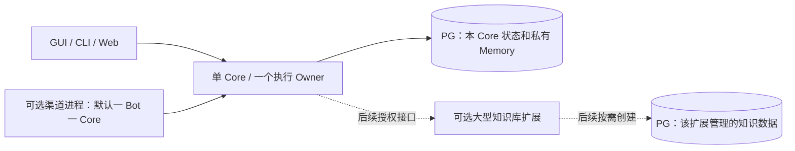

# FreeAgent PostgreSQL 数据设计指南

日期：2026-11-06（Asia/Shanghai）。状态：PG 产品后端已实现，发行与生产切换验收进行中。
配套[版本计划](FREEAGENT_NEXT_CORE_SETTINGS_RECOVERY_POSTGRESQL_PLAN_2026-11-05.md)。

**先做好一个好用的单 Core。v8.0 统一 PG，未来重能力按需启用。** 本文冻结数据归属、
顺序与事务边界；最终 DDL 从切换前已交付的 v7.16 记录生成，不提前替未来平台建空表。
普通用户只需启动、配置模型并使用对话；随包 PG 初始化与生命周期由产品完成。
数据库设计以接续、恢复、上下文和大历史交互体验为验收依据，不以实现多 Core 数量为目标。

## 1. 选型依据和本轮范围

PG 是 v8.0 起唯一的运行时数据库，包括当前会话、执行、Memory 和显式知识检索所需
记录。知识库扩展、跨 Core 协作可以不开启，默认 Core 的状态持久化仍使用 PG。
不提供 SQLite/PG 双写、运行时切换后端、SQLite 自动回退或旧库导入。

选择 PG 的主要依据是统一技术与运维方式，并为后续共享知识和协作准备条件。性能
实测证明索引仍须做好，不能把换数据库当成修复查询的替代办法：

| Hytron 隔离实验 | 实际结果 | 解释范围 |
| --- | --- | --- |
| 10 万历史 Run，当前 Core，单并发，模拟模型无等待 | 当前索引约 9.18 秒/任务；四个候选索引约 49.73ms | 前者样本少，后者 248 个样本；证明当前历史扫描有改善空间 |
| 相同规模，等价存储原型，补索引，16 路压力 | SQLite 单连接约 148 流程/秒；PG 16 连接约 265；PG 单连接约 108 | 是实际数据库原型，不是完整 PG Harness，也不是引擎的普遍性能上限 |
| 全部正式实验 | 348 轮，无操作错误，原生完整性及 UNKNOWN 恢复检查通过 | 合成输入、无真实 Provider；2 vCPU/4 GiB 限制，包含页缓存回收 |

详细原始材料在本机忽略目录 `output/db-benchmark-20261105/`，不作为发行包依赖。
近期 SQLite 索引修复仍可交付；v8.0 完成切换后，产品及真实存储测试只保留 PG 路径。

| 范围 | v8.0 交付 |
| --- | --- |
| 单 Core GUI/CLI/Web 接续、执行、审批、恢复、上下文、现有显式 Memory/知识能力 | 全部迁到 PG 并回归 |
| 随包本机 PG / 本机已有 PG | 同一 Store 实现；首次启动与排障体验优先 |
| 同一个 PG 实例上两个独立 Core | 只做隔离、连接预算和并发回归，不提供集群管理 |
| 大型共享知识库、自动知识维护、跨 Core 认领、全局拓扑 | 后续可选能力，仅遵守第 9 节原则 |
| 跨主机接管、远程 PG/TLS、分片/复制平台、跨库分布式事务 | 不在 v8.0 范围 |

## 2. 数据归属、部署和身份

### 2.1 一个 Core 的默认布局

一个 Core 对应一个逻辑 PG 数据库和独立运行角色，同库内使用应用专属 schema `fa`。
一个数据库只能有一个执行 Owner；GUI/CLI/Web attach 这个 Owner。SQL 统一显式写
`fa.<table>`，不用模型提供的字符串选择 schema、表名或数据库。

多个 Core 可共用一个 PG 服务，各自使用不同数据库和角色。共享服务不由其中一个
Core 退出时关闭。便携启动器只管理它创建的本机实例，不在 Harness 内嵌进程编排器。
独立便携包默认自管本机 PG；共用已有实例须显式配置，配置后不再另启随包实例。
不增加跨便携包发现、自动合并数据库或共享实例选主流程。



Core 可以通过获授权工具维护更大的知识集合；索引构建、批量整理和学习流程归可选
扩展。图中的后续模块不在 v8.0 默认启动，也不要求先实现它们再交付单 Core。

### 2.2 逻辑身份与运行代次

- 首次初始化生成稳定 `core_id`，保存于已有 `meta` 中；本机连接配置绑定期望的
  `core_id`、数据库和 schema 版本。认证查询成功后仍要核对身份，不能误接其他 Core。
- `core_id` 是逻辑实例身份；Owner generation 是一次运行接管的代次。进程 PID、端口、
  数据库账号和模型名称都不能代替这两个身份。
- 本库记录继续使用已有业务 ID 形式，不为了 PG 改用全新 ID 平台。跨 Core 引用必须
  带 `(core_id, record_id, revision)`；不能假设两个独立库里的短 ID 足以确定来源。
- `MemoryScope.owner` 表示现有 Agent/父 Run/集合归属，不是 OS 用户或 Owner 进程。
  迁移不能把这些“owner”含义合并。
- 从备份恢复同一 Core 保留其逻辑身份；复制成新 Core 要显式分配新身份及独立凭据，
  禁止两个正在运行的逻辑副本冒用同一实例身份。v8.0 不自动跨机器克隆或接管。

### 2.3 最小权限

| 身份 | 权限 |
| --- | --- |
| 初始化/维护身份 | 创建数据库、schema、所需扩展、DDL 与授权；仅在显式维护步骤使用 |
| Core 运行角色 | 仅本库 `fa` 的必要 DML、序列及查询权限，无 superuser/CREATEDB/CREATEROLE |
| 渠道、模型、普通工具 | 通过 Core 接口，无数据库管理凭据，不直接打开状态库 |
| 后续知识扩展 | 只访问自己管理的 PG 数据域，通过授权接口接收 Core 请求 |

撤销其他角色/PUBLIC 对私有库的不必要 CONNECT 和 schema CREATE 权限；运行角色
不成为其他 Core 角色的成员。固定 search_path，初始化和备份重建授权都进入验收。
同一 Windows/Linux 用户主动授权的 Full/host 仍遵循既有 escape hatch 边界，数据库
角色隔离不能被宣传为对抗任意同身份宿主命令的 OS 沙箱。

## 3. 现有记录怎样落到 PG

### 3.1 表和文件的职责

| 现有记录 | PG / 文件安排 | 关键约束 |
| --- | --- | --- |
| `spaces` | 本 Core PG 表 | 空间可见范围；沿用 v7.15 去平台后的绑定契约，不重新把平台运行时编入 Core |
| `conversations` | PG 表；关联 space/workspace | 增加消息/Run 局部序列计数；同一会话写入顺序可确定 |
| `runs` | PG 表；保存配置快照、状态、耗时、输出 | `UNIQUE(conversation_id, request_key)`；保留既有活跃 Run 限制 |
| `messages` | PG 表；消息内容 JSONB、明确的关系与顺序列 | `PRIMARY KEY(conversation_id,id)`，id 为会话局部序号；非空来源请求去重键唯一，普通消息允许没有该键；分支/摘要引用稳定 |
| `attempts` | PG 表；调用种类、状态、请求、结果、序号 | `UNIQUE(run_id, seq)`；UNKNOWN 与处置关联分开，禁止覆盖历史不确定性 |
| `memories` / `memory_revisions` / `memory_operations` | 沿用三类记录，放入 PG | 版本比较后更新；旧版本只读；发布请求幂等；维持现有范围授权 |
| `meta` | 小型、带命名空间的 JSONB 值 | 输入采用、控制确认、摘要、渠道回执、附件元数据、现有协作关联优先继续复用 |
| `knowledge_fts` | 删除 SQLite FTS5 实现，按 6.2 使用 PG 检索 | 不另建长期搜索数据库；保持显式检索与来源/预算边界 |
| 配置、指令与 Skills 文件 | 保留现有明确的权威文件及版本 | Run 只保存冻结快照；不为同一设置建立文件/PG 双向同步 |
| Provider/渠道/PG 凭据 | 保留受保护凭据存储，分命名空间 | DB 只保存引用；不得进入模型上下文、普通 SQL 日志或公开备份 |
| 附件与大文件 | 保留不可变文件；PG 记录归属、版本、引用与访问状态 | 本地路径不是跨 Core 文件访问能力；执行状态不依赖把大文件塞进行里 |

这是现有事实的映射，不新建八套子系统，也不预设独立 Task、Step、Checkpoint、Evidence
对象。已存在的输入状态或控制记录只有在实际热查询需要时才提取字段/表达式索引；
不一次把全部 meta 拆表，也不把所有可查询字段都塞进不可索引的大 JSON 文档。

### 3.2 字段规则

- 主外键、归属、状态、版本、排序号、常用过滤字段用类型化列；结构可变化的快照和
  Provider 结果用 JSONB。计数与耗时采用有上下界的 bigint，版本/序号单调增加。
- 时间使用 `timestamptz` 并以 UTC 输出；墙钟时间只用于展示或约定的租约判断，
  不承担消息顺序。已有实际耗时记录保持单独的数值，不能由两次墙钟相减冒充。
- JSONB 不保留原始键顺序、空白或重复键。审批摘要使用应用侧已定义的规范编码，
  所需原始确认载荷/协议字节按明确 text/bytea 或不可变文件保存；不能重序列化 JSONB
  后声称它还是原文。版本匹配后才确认，浮点/整数解码也不能悄悄改变摘要输入。
- `meta.value` 统一通过类型化序列化入口写 JSONB；字符串、布尔、整数也有明确编码，
  不把旧代码任意 raw string 直接强转 `::jsonb`。各前缀有唯一读写归属和格式校验。
- 重要关联使用 FK/唯一约束，而不只依赖调用者先查后写。删除沿用明确操作流程，
  不能通过级联删除悄悄抹掉未决执行记录。状态值迁移后仍保持既有事实含义。

## 4. 顺序、事务和 UNKNOWN

### 4.1 ID 不承担提交顺序

`messages.id` 可继续使用 bigint identity 作为稳定引用；它不代表提交先后。PG sequence
取号后即使事务回滚也可能留空洞，两个事务还可能反序提交；不能用全局 `id > last_id`
扫描多个并发会话来保证消息绝不遗漏。

- 会话增加 `last_message_seq` / `last_run_seq`。需要新增消息/Run 时先锁定该会话行，
  在同一个短事务内增加计数、插入记录并提交。一次完整消息组分配连续的一段 seq。
- Run 增加 `last_attempt_seq`；模型/工具 Attempt 按该 Run 的短事务锁分配 seq。
- 查询顺序固定为会话内 message.seq、会话内 run.seq、Run 内 attempt.seq；所有排序
  有唯一决胜键。摘要覆盖范围、分支点、待发采用与增量游标都绑定这个局部顺序。
- identity 可有空洞，业务不要求全局无缝编号。全局 UI 投影按各来源游标汇总，不把
  跨会话全局序号当成提交完整性的证明。

消息写入的事务示意（字段名最终随切换前模型核对）：

```sql
BEGIN;
SELECT id FROM fa.conversations WHERE id = $1 FOR UPDATE;
-- 同一事务核对请求键、空间授权和原输入状态；已接收的重复请求返回原关联。
UPDATE fa.conversations
SET last_message_seq = last_message_seq + 1
WHERE id = $1
RETURNING last_message_seq;
-- 使用返回的 seq 插入消息，并写入必要的输入/Run 关联；任何一步失败一起回滚。
COMMIT;
```

上述序列锁只持续数据库操作，不跨模型调用。固定锁顺序优先为会话 → Run → 输入/
Attempt/其他目标记录；需要多个同类对象时按稳定 ID 排序。具体多对象操作必须有竞态测试。

### 4.2 短事务边界

| 操作 | 同一事务包含 | 事务外执行 |
| --- | --- | --- |
| 入站接收 | 去重、完整输入/附件引用、来源/目标、待采用或拒绝结果 | 平台拉取与回执传输 |
| 输入采用 | 校验输入状态/权限、创建或关联 Run、标记采用 | 实际执行循环 |
| 工具派发 | 检查权限/审批/Owner 代次，记录 dispatched | 文件/命令/网络副作用 |
| 工具结果保存 | 按原 Attempt/代次保存 receipt、消息和状态 | 不重新执行工具 |
| Memory 修改 | 期望版本、内容与范围、版本记录和幂等回执 | 模型提炼及用户预览 |
| 附件发布 | 文件已持久化后提交可见引用 | 文件复制、校验与有限清理 |

普通操作以 READ COMMITTED＋具体行锁/条件更新起步，不全局启用 SERIALIZABLE。一致
读取和在线备份按需要使用 REPEATABLE READ；序列化冲突/死锁只能重试纯 DB 事务，
且必须确认没有在该事务中执行外部动作。

模型请求、Shell、MCP、平台发送均不能放在数据库事务中。PG 提交和外部效果不具备
共同原子性；事务提交结果未知时按原请求键/Attempt 核对，不把连接错误解释成未执行。
附件提交未知时保留正文和待核对标记；只有确认原事务结束且无引用才允许回收。

### 4.3 Owner 与恢复

Owner 使用专用直连持有 session advisory lock，不归还普通池，也不使用事务复用代理
承载这条锁连接。取得锁后更新持久化 generation；派发和回写都校验绑定代次。

失锁/失去可靠 DB 连接时停止新派发并收束已有调用；不能释放锁后仍启动新命令。
代次能拒绝旧进程写回，不能撤销已经发生的 OS/远端副作用；接替进程先核对原调用，
保持 UNKNOWN，不能因拿到锁就自动重放。

事务型请求键解决重复提交，不能承诺任意外部动作 exactly-once。v7.14 的有限模型重试、
只读核查、人工处理和原 UNKNOWN 不变的规则，在 PG 中完整保留。

## 5. 查询、索引与连接资源

### 5.1 优先保障的访问路径

| 查询 | PG 索引/约束起点 |
| --- | --- |
| 会话历史分页 | `messages(conversation_id, seq)` 唯一索引，按 seq 游标分页 |
| Run 的消息、首条输入 | `messages(run_id, seq)` |
| Run 的调用和未决调用 | `attempts(run_id, seq)` 唯一索引；是否追加 pending/dispatched/unknown 部分索引由执行计划决定 |
| UNKNOWN 核查 | `attempts(run_id) WHERE status='unknown'`，避免每轮扫描所有旧调用 |
| 最新 Run | `runs(conversation_id, seq DESC)` 唯一索引 |
| 相同请求重复提交 | `runs(conversation_id, request_key)` 唯一约束；渠道接收键另保持已有唯一性 |
| 会话/空间列表 | 围绕 space_id、置顶/更新时间的实际查询建索引，并保持分页上界 |
| Memory 范围与版本 | scope/owner/project/task/state 的实际过滤路径；`memory_revisions(entry_id, revision)` 唯一 |

保留既有活跃 Run 唯一性及 limited/UNKNOWN 的实际判断，不把旧 SQLite WHERE 子句
未经核对直接搬成 PG 约束。复用索引左前缀，不重复建立等价索引；外键不会自动生成
所有引用端查询索引，每条热路径都要检查执行计划。

不用全局 OFFSET 翻阅大历史，不每次先读整段历史再在 Go 中裁剪。大请求/结果正文
按详情加载，列表只取所需字段；避免为了一个状态查询解码整份 JSONB。JSONB 的 GIN/
表达式索引按真实查询添加，不给每个 JSON 字段默认建一套索引。

### 5.2 池和可观测性

初版普通 pgx 池建议 `MaxConns=4`、最小空闲 0；Owner 锁另占一条专用连接。该值是
待验收的起点，不因原型曾测 16 连接就给每个 Core 默认配置 16。所有 Core、锁、备份
及维护连接的总预算必须小于 PG 上限，不隐式修改共享实例的 max_connections。

连接获取、SQL、短事务均有超时，取消能传递；不修改 fsync/synchronous_commit 换取
漂亮数字。分别记录池等待、SQL/事务耗时、模型/工具耗时，避免把不同等待都归到数据库。
测试用 EXPLAIN (ANALYZE, BUFFERS) 检查实际查询；有写入的分析只在独立验证库执行。

## 6. 上下文、Memory 与 Core 自有知识

### 6.1 保持不同材料的含义

- 对话历史与摘要维持当前任务上下文；Memory 是有范围、版本和来源的参考内容；
  固定只是 Memory 的装配属性；Skill 是显式加载的方法。数据库统一不改变这些职责。
- 当前 Run 冻结选中的来源和版本，保存实际采用的引用及必要片段。下次派发仍检查
  授权/源有效性，不能静默切成新版本；被删除或撤权的来源不能借旧摘要重新放行。
- 同一请求中的同一来源/版本只装配一次；所有材料计入已有窗口预算，数据库更大不代表
  自动把更多内容塞入模型。默认不启用自动 RAG、隐式人格学习或后台知识治理。
- Owner 私聊、群空间、其他人的空间继续按统一内容授权裁决；来源、摘要、Skill 附件
  和回传结果都受同一范围约束。全局内容并不自动向所有外部空间公开。
- 经验总结 Skill 的输入脱敏、产物检查、精确内容/范围确认不随 PG 切换弱化。模型
  自报成功不是证据；UNKNOWN/部分完成不能被沉淀为确定成功经验。

### 6.2 替代 FTS5 的具体方向

当前 `searchKnowledge` 是显式授权的字面查询，FTS5 trigram 为较长查询加速，短于
三个字符时走子串匹配；并有条数、字节数及来源限制。v8.0 必须迁移这个已存在的能力。

- Memory 正文保持 TEXT。知识检索优先使用 PG 自带 `pg_trgm` 支持字面子串查询，
  通过范围/状态过滤和必要的 trigram 索引执行；不用英文 tsvector 冒充中文等价能力。
- `pg_trgm` 提取字词字符，字符分类受 locale 影响；没有可提取 trigram 的查询可能
  退化为完整索引扫描。UTF8 编码、三字以上或存在索引都不能单独证明中文查询能加速。
  固定发行版本时一起确定字符分类/排序规则，验收实际提取结果与执行计划，不沿用
  未验证的 `--locale=C` 假设，也不为此预建另一套搜索服务。
- 主版本/发行物冻结时同时核对该扩展的随包可用性；由初始化/维护身份创建，Core 运行
  角色无权自行安装扩展。缺少扩展时明确报知识检索能力不可用，不假装已完成完整验收。
  普通聊天与显式 Memory 读取不因此偷偷切到另一个数据库。
- 查询使用绑定参数，`%`、`_`、反斜线按字面转义；短词保留明确的有界子串查询与超时。
  先做范围校验，不能“全库检索后在应用里过滤”而泄露内容或集合存在性。
  仅限制返回条数不能限制扫描成本；不可索引的查询按授权集合、扫描预算和超时处理，
  未完成查询明确返回限额/超时，不把扫描到的部分结果冒充完整结果。
- 验证中文、ASCII 大小写、单字/双字、特殊字符、授权范围、删除/禁用和原文片段定位。
  排序规则保持确定性，不承诺与 FTS5 bm25 数值相同。检索索引可重建，正文和版本才是事实。
- 不强制引入 pgvector、Embedding 服务或独立搜索引擎。大型私有/共享知识库的检索和
  索引策略由后续可选扩展按需求实现，仍采用 PG 数据技术与同一上下文预算边界。

## 7. 初始化、schema、备份与文件

- 用新数据目录和空 PG 库初始化；不导入 SQLite 历史，旧数据保留可验证备份。启动时
  检查数据库身份、schema_version 与所需约束/索引，未知或更新版本拒绝写入。
- schema 版本保存在现有 meta 命名空间。变更是仓库内按顺序的 PG DDL；由显式维护
  命令持专用维护锁执行，成功后再更新版本。不运行每请求自动 ALTER，不做通用 ORM。
- 部署说明明确支持的 PG 主版本与打包依赖；运行库、UTF8/locale、SCRAM、端口冲突、
  普通用户权限与有序退出按主计划验收。DDL 的新增索引和 schema 校验一起更新。
- 在线备份让 `pg_dump --snapshot` 与附件清单采用同一导出快照；配置/Skill 副本按
  版本固定。快照要在短暂配置锁释放前真正建立，导出事务保留到使用方完成。
- 逻辑删除先撤销访问；物理回收与备份互斥，跳过提交结果未知的文件。完整备份需同时
  验证 DB、文件、配置及角色重建说明，不能把 dump 成功等同于应用已完整可恢复。
- PG 主版本升级走显式导出/导入，不复用不兼容的数据文件。恢复到新库和新目录后
  验证再启 Owner；未决调用、待发消息与渠道积压按原授权/切换规则处理，不自动重放。

## 8. v8.0 实施检查表

| 项目 | 验收方式 |
| --- | --- |
| 一个 Core 的完整日常功能 | GUI/CLI/Web 接续，工具审批与 Full 行为，上下文/压缩/Memory/附件/停止恢复都用真实 PG |
| 存储唯一性 | 产品无 SQLite driver/SQL/兜底；测试不得用 SQLite 模拟 PG 的事务语义 |
| 身份与隔离 | 两个独立库/角色不能互读；误连 core_id 被拒绝；同库第二 Owner 无法执行 |
| 并发顺序 | 故意让早取号事务晚提交/回滚，消息游标、摘要、分支和 Attempt 顺序不丢不乱 |
| 输入与确认 | 并发重复请求、接收未采用、批准时内容变化、JSONB 键序变化、取消竞态不重复作用 |
| 连接与恢复 | 失锁、池耗尽、死锁、提交回执丢失、命令已执行但结果保存失败保留真实事实 |
| 文件与备份 | 附件提交未知不被回收；写入/删除并行备份恢复可核对；缺文件和磁盘满明确失败 |
| 检索与授权 | 6.2 字面检索用例、跨空间拒绝、选定版本/固定取消/撤权有效 |
| 性能 | 复用 10 万历史级别的负载，报告 SQL 计划、p50/p95、样本数、池等待和启动成本，不靠关闭同步提交 |
| 发行 | 干净 Windows 双击与 Debian 12 非 root；客户端退出/后台命令/自管与外部 PG 边界正确 |

以上是单 Core 的退出门槛。两个独立库的回归用于避免同机多实例互相影响，不要求主 Core
调度其他 Core、共享知识库成品或分布式数据库上线后才能发布 v8.0。

## 9. 后续扩展仅保留的原则

### 9.1 私有大知识库与共享知识

可选扩展管理自己的 PG 数据域，一份知识正文有一个权威位置；Core 引用来源、记录和
版本，不默认各自复制全部知识。私有大知识库只授权对应 Core，共享集合按具体身份/
空间授权，不能因共用 PG 服务就获得其他 Core 的对话或秘密。

后续记录至少能表达集合/文档身份、版本、来源引用、正文或文件引用、适用范围和有效
状态；检索索引记录自己处理的版本。摘要、片段和索引可以重建，不替代原文。知识修改
使用期望版本与幂等请求；发布失败后可独立重试，不要求与来源 Core 的状态库跨库提交。
自动维护的启用、权限和确认规则在该扩展实施时明确；本轮不改变既有持久化确认边界。

### 9.2 认领、租约与执行拓扑

未来需要多个 Core 竞争工作时，领取事实必须在参与者共同使用的协调域中；各私有库
的行锁不会跨数据库协同。优先延用现有 Run/协作关联，再按真实查询需要组织领取记录，
不提前另建 Task 平台。

领取可用短事务中的 `FOR UPDATE SKIP LOCKED`＋条件更新，记录负责 Core、代次和
有限租约后立即提交。锁不跨模型/工具执行；续租、完成、取消都校验原领取代次。
到期只表示需核查，不能证明旧进程停止或工具未生效；不依赖行锁承诺外部 exactly-once。

主 Core 的全局拓扑从父子 Run、依赖、负责 Core、领取状态和结果引用生成，带来源版本/
观测时间；失联显示未知，不当作空闲。拓扑是可重建投影，不另建图数据库或第二份执行事实。

接口保留版本号和能力授权原则，禁止直接读写其他 Core 的私有库；具体协议与表在功能
落地时确定，不强迫知识检索、渠道入站和执行调度使用完全相同的接口。
跨机复制、分片、自动故障转移和资源编排等，等单 Core 与实际共享需求稳定后再设计。

## 10. 核查依据

当前实现依据：`internal/harness/store.go`、`memory.go`、`input_queue.go`、
`attachments.go`、`collaboration_budget.go` 及既有控制确认/上下文代码。
运行时 DDL 见 `internal/harness/postgres_schema.sql`，Owner、事务和备份实现见
`postgres_store.go`、`postgres_transactions.go`、`postgres_backup.go`。具体已验与未验项
以实施进度和发行验收记录为准。

2026-11-06 核对的官方说明：

- [PG JSON 与 JSONB 的字节表示差异](https://www.postgresql.org/docs/current/datatype-json.html)。
- [Sequence 分配、回滚与空洞](https://www.postgresql.org/docs/current/functions-sequence.html)。
- [行锁与 session/transaction advisory lock](https://www.postgresql.org/docs/current/explicit-locking.html)。
- [SKIP LOCKED 的队列用途与不一致视图限制](https://www.postgresql.org/docs/current/sql-select.html)。
- [pg_trgm 索引与无可提取 trigram 的退化情况](https://www.postgresql.org/docs/15/pgtrgm.html)。
- [Locale 与 LC_CTYPE 字符分类](https://www.postgresql.org/docs/15/locale.html)。

文中的 SQL 是事务语义示意；产品使用固定 PG 15.19，并在真实 PG 上测试。
Windows/Debian、真实 Provider 与最终部署证据见实施进度；文档本身不替代测试结果。
