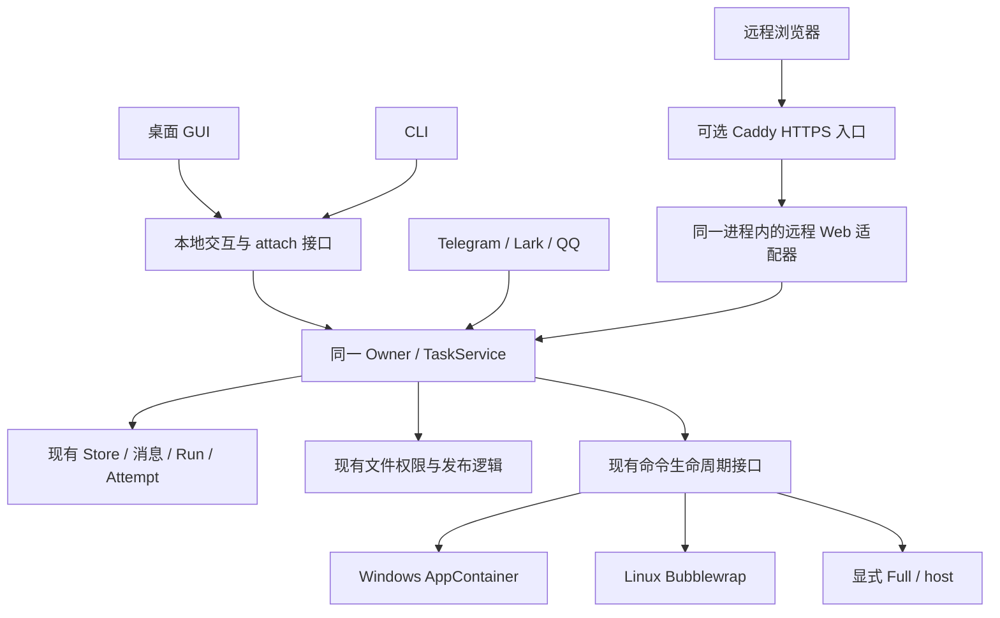

# FreeAgent v7.7–v7.10：接续、发布、服务器、附件与公网入口

日期：2026-11-02；2026-11-03 按计划审查和用户确认修订。状态：计划已定稿，可作为分阶段实施基线；各阶段实现与验收按实际结果记录。

基线：本地 `v7.7.0-dev.1`，HEAD `6b9e0aee2c52b7432aa75d9fbea835d20043812b`，保留当前全部未提交开发成果。2026-11-02 核对的 GitHub 主分支仍为该提交，最新预发布为 `v7.4.0-dev.1`。已有结果见 [v7.7 实施记录](FREEAGENT_V7_7_IMPLEMENTATION_PROGRESS.md)和 [Debian 12 验收记录](FREEAGENT_V7_7_LINUX_ACCEPTANCE_2026-10-29.md)。这些历史结果只证明当时对应的代码和包。

本计划覆盖用户指定的六项工作：补齐接续和使用说明、完成 v7.7 可重复发布、服务器部署、附件输入和结果回传、可选公网 Web、Linux 命令沙箱。默认使用场景是一个用户管理自己的 FreeAgent 实例。本文中的新命令、字段和文件名是拟实现接口；没有标为“已有”的接口不能当作当前可用命令执行。

## 1. 交付顺序和产品结果

| 阶段 | 用户得到的结果 | 依赖 | 发布方式 |
|---|---|---|---|
| v7.7 收尾 A | GUI 开着也能用一次性 CLI 结束任务、在线备份；沙箱命令不能改写 Git 元数据；SSH 隧道可用任意本地端口，令牌不随 cookie 外泄；Provider 默认关闭、按需开启 | 当前代码 | 合入本次 v7.7 收尾 |
| v7.7 收尾 B | GitHub 上的 Windows/Linux 包来自同一明确提交，能够重复构建、校验和复测 | A | 新的 v7.7 预发布；不覆盖已有标签或资产 |
| v7.8-A | Debian 12 上以普通用户常驻，退出、重启、日志和本机接续清楚可控 | v7.7 发布基线 | 服务器阶段预览 |
| v7.8-B | Linux 的 Ask/Workspace 能使用真正的命令隔离，首版沙箱不联网；Full 保留显式宿主执行 | A 的生命周期与部署基线 | 合并为 v7.8 交付 |
| v7.9-A | GUI/CLI 上传文本、选取图片、下载执行结果；重启与备份保留附件 | 统一记录与文件权限 | 附件阶段预览 |
| v7.9-B | 图片映射到已支持的 Provider 协议；渠道按实际能力收发附件，None 空间也能把回复另存为文件 | A；平台接口核对 | 合并为 v7.9，真实平台未验部分明确标注 |
| v7.10 | 可选单用户公网 Web，仅限 Linux 服务器：HTTPS 登录后使用同一套对话、审批、文件和执行记录；登录锁定、IP 名单、Cookie 检测等安全设置由用户逐项开关 | 服务器、附件边界通过；Linux 沙箱已验收，或确认不可用（沙箱命令照常拒绝） | 独立开关，默认关闭 |

A/B 是实施分段，不创建不同产品、不同执行器或不同数据体系。公网原型可以提前验证登录与流式连接，但在依赖验收完成前不宣称公网版本可交付。

真实 Telegram/Lark/QQ 账号测试仍受外部条件限制；它们不阻止不依赖平台的本地开发。带 NOT_RUN 的渠道继续作为预览功能，不将“本地模拟通过”改写为“真实接入通过”。

## 2. 全程保持的边界

1. 一个 Owner、一套 TaskService、一套 Store；GUI、CLI、渠道和公网 Web 都是入口。继续使用现有 Run、Attempt、消息、审批、命令和交付凭据。
2. 空间与实际发起人的权限取低，仍为 `None < Ask < Workspace < Full`。新实例、新空间和新人员默认 None，Provider 默认关闭；安装服务或开启公网入口均不自动授予 Full。
3. AI 提议的产品持久设置必须经过现有预览/确认。文件、命令和新增文件导出工具继续遵守现有权限与工具审批，不能给 Full 普遍增加一套确认码。
4. 所有新增产品设置都进入同一控制目录，提供 GUI、CLI 和 AI 提议入口。秘密由用户直接在受保护输入中提供，不放入模型上下文。OS 服务安装、证书私钥和管理员恢复需要相应 OS 权限；AI 可以生成具体方案并在具备权限时执行，权限不足须返回实际阻塞，不能显示“已设置”。
5. 不做旧平台兼容、迁移器或旧库自动升级。没有格式变化时不为版本号另建数据体系；有不兼容变化时选用独立的新格式和目录，旧数据保留，旧程序拒绝误读。
6. 不增加自动 RAG、隐式学习、后台知识治理、多租户、组织权限、插件市场、容器编排或模块生命周期平台。
7. Stop、进程退出和副作用结果分别记录。UNKNOWN 不自动重试；重连、Owner 重启、服务自动拉起均不能自动重放模型、工具或未知的渠道发送。
8. Full/host 仍是同一 OS 用户权限的显式宿主入口，可以接触该用户可访问的文件和进程。它不作为控制面隔离或沙箱安全的验收证据。若要求抵抗用户主动授权的 Full 命令，需要另外的 OS 身份/代理设计，不在本计划内暗中承诺。
9. Bubblewrap、systemd 部署和 TLS 代理为可选依赖。默认便携包仍可直接使用 CLI/Web，不因缺少可选依赖无法聊天。
10. 测试失败先定位、修复、重测。没有实际运行的场景标明 NOT_RUN；主机缺少必要隔离能力时标明 NOT_SUPPORTED，不能回退宿主执行后显示成功。

## 3. 架构与复用位置



远程适配器负责登录会话、请求校验和浏览器传输；业务操作调用同一服务方法，不写另一套对话、配置或执行逻辑。附件使用现有消息中的引用与受保护的二进制存储目录，不新建任务或证据系统。命令隔离扩展现有进程接口，首版不为包名整库搬迁 `internal/winlaunch`。

## 4. v7.7 收尾 A：接续、使用说明与 Provider 开关

### 4.1 已核实的问题

- 一次性 CLI 中只有 `abandon` 和 `backup` 仍直接调用 `harness.OpenStore`，Owner 在线时会失败。`run`、`continue`、`confirm`、`preview`、`control`、`config`、`key`、`spaces`、`channel`、`context`、`memory`、`commands`、`collab`、`chat` 已接入 attach；`sessions`、`inspect` 和协作查询在 Owner 在线时降级为只读视图。交互式 CLI `/abandon` 已有远程路径，可以复用。
- `backup` 不能在线运行：服务器做不了日常在线备份，6.3 更新流程中的“先备份再停服务”也无法执行。
- 开启 `git_write` 后，现有保护只把 `.git` 下的 `hooks`、`config`、`config.worktree`、`modules` 和 `worktrees` 设为只读，沙箱仍可在 `.git` 下新建文件。Git 会读取 `.git/commondir`，改从它指向的目录读取 config 和 hooks。沙箱可以借此让 `commondir` 指向工作区内自建的目录，在其中放入带 `core.fsmonitor` 等设置的配置；用户或编辑器之后在宿主运行 `git status`，就会执行沙箱写入的命令，而许多编辑器会在后台自动运行 `git status`。该开关默认关闭，Windows 现有实现受影响；结论来自代码和 Git 源码，尚未实际复现。
- 这个缺口不能靠占位文件堵住：`commondir` 存在但为空时，Git 会直接报错退出。按名称逐个保护也难以覆盖其他会被宿主 Git 执行的状态，例如 `.git/rebase-merge` 待办中的 `exec` 行，会在用户继续 rebase 时执行。
- `internal/chatui/server.go` 要求 Host 与监听地址完全相同。`docs/LINUX_PORTABLE.md` 现有的“本地 8765 转发到远端任意端口”示例，在两端端口不同时会被拒绝。
- 事件流依靠 `freeagent-chat` cookie 认证，而 cookie 不按端口隔离（RFC 6265 §8.5）。通过 SSH 隧道在日常浏览器中打开后，这个能控制整个实例的令牌会随请求发给用户电脑上其他 `127.0.0.1` 端口服务的 `/api/` 路径。
- 一些运行时配置失败只返回 `attention` 或通用提示。需要在现有错误分类中提供可操作的原因，避免用户反复切换开关。

### 4.2 修改方案

1. 一次性 `abandon --run` 检测到已有 Owner 时使用交互 attach，调用现有结束任务方法。Observer attach 不因此获得变更权限。
2. 继续按指定 Run 和原发起人处理，保留协作父任务的既有停止语义。不得依赖前端当前选中的对话，也不得改变另一会话的状态。
3. Owner 世代变化、退出中、握手失败均返回明确结果。只有确认没有 Owner、正常获得存储锁时才走本地操作；不能因网络错误另开写入者。
4. `backup --out` 在 Owner 在线时经交互 attach 交给 Owner，调用现有 `Store.Backup` 生成一致快照；CLI 先把目标解析为绝对路径，Owner 沿用现有目标规则，Observer 拒绝。离线时保持现有本地路径。其余变更命令已接入 attach，只补“Owner 切换中”的对照测试，不重写已经共用的路径。
5. 停用 `git_write`：Windows 与后续 Linux 沙箱内整个 `.git` 一律只读，删除 `ProtectGitWrite` 模式、GUI 复选框和 CLI `--git-write`，保存请求中的 `git_write=true` 被拒绝。配置读取拒绝未知字段，所以当前格式暂留该字段，读取时一律按关闭处理，并在设置页和 `config show` 中说明已停用；v7.9 换格式时删除字段。需要提交时由用户在宿主操作，或明确使用 Full；单条命令的宿主执行审批以后单独规划。
6. Host 接受数值回环地址 `127.0.0.1` 和 `[::1]` 的任意端口；Origin 存在时必须与 `http://` 加请求 Host 完全一致；`localhost`、域名和非回环地址仍拒绝，cross-site 请求仍拒绝。DNS 重绑定请求的 Host 是攻击者域名，仍会被拒绝；SSH 隧道因此可用任意本地端口。
7. 删除 `freeagent-chat` cookie。事件流改为带 `X-FreeAgent-Key` 请求头的流式 fetch，断线后按现有快照与游标重连；v7.9 的下载同样用请求头。桌面 WebView2 与浏览器共用这一实现。
8. 对不存在的可执行文件、符号链接目标、缺少沙箱、配置被其他会话阻挡等错误，返回稳定错误码、简短原因和下一步。脱敏仍使用现有机制。
9. 修正 Linux 文档，区分“本机浏览器”“SSH 隧道”“常驻服务”“后续公网入口”。默认说明使用数值地址 `127.0.0.1`，不把 `localhost` 当作等价 Origin。

修复后的文档示例：

```sh
# 服务器：已有 web --port 参数；端口被占用时选择另一空闲端口。
./FreeAgent web --port 8765

# 用户电脑：只绑定本机回环；本地端口可以与服务器端口不同。
ssh -N -o ExitOnForwardFailure=yes -L 127.0.0.1:18765:127.0.0.1:8765 USER@SERVER
```

本地打开 `http://127.0.0.1:18765/#key=服务器本次启动给出的值`。修复发布之前的 `v7.7.0-dev.1` 仍要求两端端口相同。隧道关闭只断开访问，停止 Owner 需要明确操作。文档不能公开实际令牌。

### 4.3 验收

- Owner 在线：一次性 CLI 能结束自己的 waiting/stopped/UNKNOWN 任务，重复请求不重复产生副作用。
- 两个会话并行：结束 A 不改变 B；原请求人、权限、UNKNOWN Attempt 和审批内容保持一致。
- Owner 更换、过期发现文件、连接断开和错误身份均拒绝错误执行；无 Owner 时原本地用法仍可用。
- Owner 在线时 `backup --out` 生成的备份能通过 `backup-verify` 并恢复；Observer 身份和已存在的目标被拒绝。
- Windows 沙箱命令不能在 `.git` 下新建 `commondir`、改动 hooks/config 或写入任何内容，之后在宿主运行 `git status` 不会执行沙箱提供的命令；已有 `git_write=true` 的配置按关闭处理并显示原因。
- 全新目录按文档实际建立 SSH 隧道，同端口和异端口都能正常使用页面、JSON 请求和事件流；Host 为域名、`localhost` 或非回环地址，Origin 与 Host 不一致，以及 cross-site 请求均被拒绝。浏览器中不再出现 `freeagent-chat` cookie。
- Windows 桌面 → CLI → 桌面与 Debian Web → CLI → Web 各跑一次实际接续。

主要落点：`cmd/freeagent/main.go`、`attach.go`、`chat_client.go`、`config.go`；`internal/harness/commands.go`、`config.go` 和 `internal/winlaunch` 的 Git 保护；`internal/chatui` 的 Host 校验与事件流；必要的 `internal/handoff` 适配；`docs/LINUX_PORTABLE.md`、`docs/PORTABLE.md`。

### 4.4 Provider 开关

每个模型 Key 配置（`openai-compatible` 或 `anthropic` 协议）就是一个 Provider 实例，包括由预设创建的和自定义的，各有一个开关，默认关闭，用户按需开启。关闭的 Provider 保留 Key 和模型条目，重新开启即可使用。Telegram、Lark、QQ 的凭据也存在 `keys.json` 中，但由渠道自己的开关管理；本地 Echo 模型同样不属于 Provider。

1. 启用状态是产品设置，写在 config 中，与 Skills、扩展的开关同类；`keys.json` 只存连接信息和秘密。新数据目录中全部关闭，新添加的 Key 配置也默认关闭。当前格式新增这一字段：读到缺少该字段的旧配置时一律按关闭处理，升级后逐个开启，不做迁移；旧程序读到新字段会拒绝读取。
2. GUI 的 Key 管理页改为 Provider 页，列出预设和已添加的 Provider，每项一个开关。开启尚未配置的预设时，先填写必要的连接信息，保存时明确选择是否开启；测试连接由用户单独触发，不作为保存或启用的前提。CLI `key add` 默认保存为关闭，只有显式 `--enable` 才启用，另提供 `key enable` 和 `key disable`，`key list` 显示状态。AI 可以提出开启或关闭具体 Provider，经现有预览和确认后生效，不接触 Key 正文。
3. 关闭的 Provider 不参与任何自动调用或模型调用：运行时不解析秘密、不获取模型列表、不发模型请求，它的模型从模型选择、默认模型候选和 Auto 候选中隐藏。用户在 GUI 明确测试连接或获取模型列表、在 CLI 明确执行对应诊断命令时，可以进行该次诊断；诊断不自动开启 Provider。保存配置、启用开关和程序启动本身均不隐式联网。
4. 默认模型、对话已选模型、空间或渠道使用的模型、协作设置引用到关闭的 Provider 时，界面标明“Provider 已关闭”，并提供开启或改选，不自动换成其他 Provider 的模型。这类请求在派发前就失败，记为确定失败，不产生 UNKNOWN；渠道消息同样回复明确原因。
5. 关闭只影响之后的请求。已经发出的请求按原有规则完成或停止，不会被重试或重发；Run 的下一次模型调用遇到关闭的 Provider 时停止并说明原因，开启后可以继续。

验收：新数据目录中没有任何对外模型请求（用本地 HTTP 夹具计数），聊天界面提示开启 Provider；开启后模型选择、默认模型和 Auto 可用，关闭后立即隐藏，下一次请求在派发前失败；Key 与模型条目在开关前后保持不变；GUI、CLI 和 AI 提案修改的是同一设置，Owner 在线时 CLI 经 attach 修改；已有 v7.7 开发数据升级后 Provider 显示为关闭，逐个开启后恢复使用。

同步更新便携包、smoke 和真实 Provider 验收脚本：需要发出模型请求的夹具显式开启对应 Provider，只检查密钥保存的夹具保持关闭。测试应覆盖保存/启用不联网、显式诊断不自动启用，以及停用不会改写之前已存在的 UNKNOWN 结果。

主要落点：`internal/harness/config.go`、`keys.go`，`runtime.go` 的模型解析与 Auto 候选，`control.go` 控制目录，`internal/chatui` 的 Provider 页，`cmd/freeagent/key.go`，`internal/channels` 的错误回复。

## 5. v7.7 收尾 B：可重复构建与发布

### 5.1 完成标准

同时满足三项：源码提交可追溯；相同平台、固定工具链的两次干净构建得到相同未签名包 SHA256；发布出去的就是已经验收的那份包。

不要求 Windows ZIP 与 Linux tar.gz 相同，也不把任意编译器版本、任意压缩库版本的跨环境输出声明为字节相同。

### 5.2 构建与资产

1. 整理当前改动并提交，保留精简成果；从独立干净 checkout 构建。发布模式遇到 dirty 源码直接失败。本地开发包可显式允许 dirty，但必须带标记。
2. 固定 Go、Node、pnpm、Python 和构建镜像/工具版本，保留 lockfile、模块校验和以及目标架构参数。CI action 使用固定修订；升级工具链作为明确变更。
3. `internal/chatui/dist` 已纳入版本控制，发布以提交中的 dist 为准。CI 按锁文件重新构建前端，与提交内容逐字节比较，不一致即失败；Windows 和 Linux 构建都嵌入这份已提交的 dist，不各自重建。源码清单必须包含 dist、前端源代码和锁文件、桌面资源、实际打包文档、许可证及构建脚本；修正当前 Windows 清单排除 dist 的问题。
4. 统一源码清单的路径格式、排序、编码和换行。当前 `.gitattributes` 只为 `docs/*.md`、`*.ps1`、工作流、NOTICES 和 VERSION 指定 LF；改为全仓库 `* text=auto eol=lf`，把 woff2、png、syso 标为 binary，并单独提交一次换行规范化，避免 Windows checkout 改变输入字节。仓库中没有需要 CRLF 的 cmd/bat 文件。
5. 构建时使用提交时间作为 `SOURCE_DATE_EPOCH`。包内 manifest 使用含义明确的源码/归档参考时间，ZIP 条目时间、tar 元数据和 gzip 时间头均固定；不把提交时间冒充真实构建时间，真实构建与验收时间写到包外记录。
6. 抽取小的标准库打包辅助脚本，统一清单、哈希与确定性归档。现有 PowerShell/Python 构建入口仍负责平台构建，不引入构建服务。
7. 每个平台在两个全新目录重复构建并比较最终归档及内部文件哈希。差异须定位到输入、二进制、前端或归档元数据，不能只比较 `--version`。
8. 一个 Release 使用合并后的 `SHA256SUMS.txt`，包含两个平台包，避免两份同名清单互相覆盖；平台构建与验收 JSON 使用带平台名的文件名。
9. 发行资产包括 Windows ZIP、Linux amd64 tar.gz、合并校验和、源码输入清单和平台验收摘要。生产签名不在本轮前置范围；仍清楚标记未签名。

### 5.3 自动检查与发布门槛

| 检查 | 要求 |
|---|---|
| Windows/Linux 普通 Go、vet、模块校验 | 对实际发布提交运行 |
| Windows 原生 race | 明确安装/选择可用 GCC，记录版本和 CGO；不能以 Linux race 替代 |
| Linux race | 保留现有检查；Debian 12 使用普通用户执行对应验收 |
| ChatUI JS 和产物 | JS 测试、生产构建通过；重建产物与提交中的 dist 逐字节一致 |
| Windows 便携启动 | 新目录首次启动、关闭/重开、正确 CLI 引擎、WebView2/已有后备路径及 CLI 接续 |
| Linux 便携 | 静态 ELF、权限、LF、路径特殊字符、启动/停止/备份/接续；复用已有脚本 |
| 两次干净构建 | 每个平台最终未签名归档哈希相同 |
| 干净包 | 不含用户数据、测试配置、Key、服务密码、日志或临时凭据 |

GitHub CI 加入上述可自动运行的门槛。无交互桌面或缺少 WebView2 的 runner 不能声称完成原生 GUI 验收；补充对同一包哈希的实际桌面记录。Debian 12 容器可以验 CLI/打包，但后续 systemd、用户命名空间和真实隔离需在可用 VM/实际主机上验。

流程为：准备发行说明 → 固定提交/版本 → 构建 → 验收 → 上传同一资产 → 校验下载哈希 → 发布。失败保留草稿或本地结果，修复后重跑受影响门槛。包被改动后必须重新验收。

v7.7 先发新的预发布版本，不覆盖现有 `v7.7.0-dev.1` 本地证据，也不修改已发布的 v7.4 标签。Telegram/Lark/QQ 与当前真实 Provider 的未验项留在发行说明中；不能为了发布改为 PASS。

主要落点：两份现有构建脚本、便携验收脚本、`.github/workflows/test.yml`、新增发行 workflow 与小型归档辅助脚本、版本与发行说明。

## 6. v7.8-A：服务器常驻和运维

### 6.1 使用方式与目录

保留便携模式。新增 `web --service` 运行方式，继续调用现有 `startLocalOwner`；不再要求一个终端常开，也不另建 daemon 或任务调度器。

建议安装布局：

```text
/opt/freeagent/releases/<version>/     管理员安装的只读程序
/opt/freeagent/current -> releases/... 管理员明确切换的当前程序
/var/lib/freeagent/data/<format>/      当前独立数据目录
/var/lib/freeagent/workspace/          默认工作区
/var/lib/freeagent/keys.json           当前服务用户的密钥文件
/run/freeagent/                       受限的临时运行文件
```

部署模板显式指定 data-dir、workspace 和 keys-file，不依赖 root 的 HOME 或调用人的默认目录。使用专门的普通服务用户，不授予 sudo，不共用现有业务的账号和目录。安装、移除模板不删除用户数据；移除数据必须另行明确指定。

服务器上的 CLI 一律以服务用户身份运行。增加 `FREEAGENT_DATA_DIR`，与现有 `FREEAGENT_KEYS_FILE` 一样只作显式覆盖，不回退到其他目录；unit 和安装脚本生成的管理命令（建议 `/usr/local/bin/freeagent`）都用这两个变量。管理命令只执行 `runuser -u <服务用户>`、设置这两个变量并原样传递参数，管理员登录后直接使用；安装脚本遇到同名的未知文件时不覆盖。Linux 上当前有效 UID 与数据目录所有者不一致时，除 `--version`、`help` 和 `backup-verify` 外的命令一律拒绝，并提示使用管理命令；`init` 和 `restore` 检查目标的上级目录。否则 root 在服务停止时运行 `key`、`config` 等命令，替换后的文件会归 root 所有，服务随后读不到而启动失败。unit 用 `User=`、`StateDirectory=`、`RuntimeDirectory=` 和 `UMask=0077` 建立目录所有权。`web --service` 拒绝以 root 运行；便携方式以 root 运行时，状态区和运行环境说明标明 Full 等于 root 权限。

### 6.2 最小生命周期

- 提供 systemd unit 模板和显式安装脚本；安装前检查实际端口、路径、权限及目标机器已有服务。重复运行不覆盖未知自定义 unit。
- 以 `Type=exec` 启动进程，应用就绪由 Owner 状态/本地健康检查确认；systemd 显示 active 不等于模型或渠道可用。
- 使用 `Restart=on-failure`、有界重启频率、停止宽限和 `KillMode=control-group`；正常手动停止不被重新拉起。Owner 进程恢复只恢复记录与监听，不恢复执行未完成任务。
- unit 加固必须与 Bubblewrap 一起验证。seccomp 过滤、namespace 限制和内存保护会被 unit 内所有子进程继承，包括沙箱命令；冲突项见下表。不能用禁止 namespace 的 unit 配置把沙箱禁掉，再用 Full 绕过。
- 不授予任意 systemd 单元控制、Docker socket 或宿主总线访问。系统服务管理的是这一实例；命令/有限服务仍使用已有配额、时长与停止规则。
- 增加 `owner status`、`owner url`、`owner stop` 薄入口，复用发现文件与 attach。status 默认脱敏；url 仅供具备本机访问资格的用户主动获取；stop 先排空/停止所属操作并保留记录。
- service 模式不把含本地交互令牌的启动 URL 打进 journald。日志包含版本、世代、状态和脱敏错误，不记录口令、Key、完整请求正文或附件内容。
- GUI/CLI 状态区显示运行方式、监听地址、实际隔离后端及不可用原因。安装缺失、端口冲突、权限不足和 Key 不可用须有区别。

| unit 选项 | 与沙箱的关系 | 模板处理 |
|---|---|---|
| `RestrictNamespaces=` | 设为 yes 时禁止建立任何 namespace，bwrap 无法运行 | 不设；确需设置时放行 bwrap 实际使用的类型 |
| `SystemCallFilter=@system-service` | 该组不含 `@mount`，bwrap 需要 mount 和 pivot_root | 不设，或同时放行 `@mount` |
| `RestrictAddressFamilies=` | bwrap 在新网络 namespace 中通过 NETLINK_ROUTE 配置回环 | 设置时必须包含 `AF_NETLINK` |
| `MemoryDenyWriteExecute=` | 作用于 unit 内所有进程，与 JIT 不兼容，沙箱里的 Node、Java 等会失败 | 不设 |
| `ProtectKernelTunables=`、`ProtectProc=`、`ProcSubset=` | 遮盖或改变宿主 `/proc`，可能导致沙箱内无法挂载新的 proc | 实测通过才启用 |
| `ProtectSystem=strict` | 宿主文件系统只读，额外授权根会写入失败 | 可用；额外授权根列入 `ReadWritePaths=`，状态区显示实际可写性 |
| `ProtectHome=` | 隐藏或只读化 `/home` | 授权根都不在 `/home` 下时可用 |
| `NoNewPrivileges=` | 非 setuid 方式的 bwrap 不受影响 | 可用；启动探测确认 bwrap 不是 setuid 安装 |

表中判断来自 Debian 12 官方手册和 bwrap 源码，全部需要在 Debian 12 的服务内实测。

服务内的 Full 实际等于服务用户在 systemd 外层限制内的权限，不等于 root。执行事实应进入当前运行环境说明，避免界面或模型把 Full 描述成已取得管理员权限。

### 6.3 更新和恢复

下载并验证新包 → 停止接收新任务 → 按现有规则停止/处理执行 → 备份 → 停服务并确认所属进程 → 切换程序 → 启动并检查 → 恢复入口。不得在旧实例仍持有 Store 时启动第二个 Owner。

只有格式一致的当前数据才允许原样继续使用；不兼容格式使用新目录。程序回退只能配套它自己能读取的数据/备份，不能让旧二进制写新库。程序切换不承诺撤销文件或外部操作的既有副作用。本轮不加入自动更新器。

日常备份使用 4.2 的在线备份；更新流程中的备份同样可以在线完成，也可以在停服务后离线执行。

v7.9 会更换数据格式（见 8.6）且不提供迁移，v7.8 及更早版本的对话和设置不会进入 v7.9：新版本使用新的数据目录，旧目录留给旧程序。v7.8 服务器版因此标为预览，发行说明写明这一点；需要长期保存的服务器数据从 v7.9 开始。v7.10 的公网凭据放在独立的受保护文件，登录会话只在内存，计划不再更换数据格式。

### 6.4 验收

- Debian 12 新账号/新目录安装、启停、重启、开机启动、目录含空格、端口冲突与配置错误。
- 关闭 SSH 后服务仍在；通过 CLI、隧道浏览器接续同一对话；Owner 退出/重启后凭据和世代变化正确。
- 在模型请求、文件操作、后台命令、审批等待中分别模拟异常退出；重启后保留真实记录与 UNKNOWN，不自动重放。
- `systemctl stop/restart` 后验证所属子进程，包括创建新会话/进程组的子进程；不得误杀其他服务。Host 主动逃离或请求外部服务产生的进程不伪称受控。
- 实际八小时持续运行：低频对话、两会话交替工作、有限服务到期、日志与内存增长、一次明确重连。记录实测资源趋势和清理结果；模拟八小时不能替代此项。
- 自动重启次数和磁盘写入有界；所有启停错误可诊断。安装/卸载后现有服务器业务保持正常。
- root 对服务数据目录直接运行 CLI 被拒绝并提示管理命令；管理命令以服务用户身份正常工作；`web --service` 以 root 启动被拒绝。
- 使用发行模板的全部加固选项，在服务内实际运行 Linux 沙箱命令（见 7.4）；Owner 在线时完成一次备份并通过校验。

主要落点：`cmd/freeagent/web.go`、`owner.go`、`main.go` 的身份检查、`internal/apppaths` 的 `FREEAGENT_DATA_DIR`、`internal/handoff`、现有关闭/恢复路径、部署脚本和 `docs/SERVER_DEPLOYMENT.md`。

## 7. v7.8-B：Linux 命令沙箱

### 7.1 技术选择

| 方案 | 取舍 |
|---|---|
| 只依赖 systemd unit 和进程组 | 适合管理整个实例生命周期，不能表达每次 Run 的文件授权，不能当命令沙箱 |
| **Bubblewrap + 现有命令接口** | 选用；按当前执行配置构造文件/进程/网络隔离，额外依赖小，可明确探测能力 |
| Docker/Podman 为每个任务创建容器 | 本轮不选；引入镜像、挂载、守护进程或额外生命周期 |
| 自研完整 namespace/挂载管理器 | 本轮不选；把 OS 隔离的复杂性放进 Harness 不划算 |

Bubblewrap 只提供构建隔离环境的工具，具体边界取决于启动参数与挂载布局；不能因为启动了 bwrap 就报告“安全沙箱”。首个实施门槛是 Debian 12 上的隔离原型与负向测试，而不是先做好开关。

### 7.2 首版支持范围

| 模式 | Linux 行为 |
|---|---|
| None | 不提供、不执行 command_run |
| Ask | 审批继续用现有逻辑；沙箱按冻结 profile 挂载，默认工作区只读。确认不是隐式扩权 |
| Workspace | 授权工作区及明确允许的根目录按 profile 可写，其他内容不可见或只读 |
| Full | 保留显式 host 执行及 `host_escape_hatch=true`；不会伪装成 Linux 沙箱 |
| 沙箱网络 off | 必交；独立网络 namespace，不能访问互联网、宿主 loopback 或现有 Owner |
| 沙箱网络 internet | 首版 NOT_SUPPORTED；不使用共享宿主网络冒充隔离联网 |
| 普通/后台命令 | 必交；沿用现有超时、输出、配额与停止 |
| 面向宿主可访问的沙箱服务端口 | 本轮 NOT_SUPPORTED；现有有限服务继续显式 Full/host |

Windows AppContainer 沙箱可以按配置联网，Linux 首版不能。设置页、`config` CLI 和 AI 提案在用户选择或提议“沙箱命令联网”时直接说明 Linux 上只能改用 Full；状态区显示当前平台沙箱的网络能力。服务器上的依赖安装、`git clone` 等联网任务因此更多会走 Full；公网入口开启后，远程会话同样可以使用 Full（见 9.3、9.4）。Linux 沙箱联网列为后续独立计划，候选为不接触宿主回环的用户态网络（如 slirp4netns、pasta），需单独验证。

Owner 自己的 Provider/渠道网络请求不受命令的 network-off 限制；网络政策是按执行对象划分的。沙箱不可用不影响纯聊天、已有文件工具或用户主动选择的 Full，但请求沙箱的那次命令必须拒绝。

### 7.3 实现要求

1. 复用现有 `Spec`/`Process`、命令记录、预算和凭据；增加 Linux 后端与能力探测，按 build tags 选择。拆开当前将所有沙箱都转成 AppContainer 的组装逻辑，保留 Windows 行为。
2. 使用系统安装、经过校验的 bwrap。探测普通用户 namespace、PID/mount/network 隔离和所需选项；不能只检查 PATH。依赖安装需明确执行，不在普通启动时改内核 sysctl 或全局权限。
3. 从空的挂载视图开始，只提供必需的系统运行库/程序、少量系统配置、当前授权根、独立 HOME/tmp、受限 dev/proc。禁止直接只读挂载整个 `/` 或整个用户 HOME。
4. 程序安装根只读，不能与数据、Key、附件、控制文件或被阻止的目录重叠。工作区及授权根中的 `.freeagent`、`.git` 和当前黑名单按既有策略保护，`.git` 整体只读（见 4.2），不能仅在模型工具描述里隐藏。
5. 不带入宿主 SSH agent、Docker/systemd/D-Bus socket、设备或私有运行目录。环境使用必要变量白名单，Provider/渠道凭据及引用它们的环境变量不传入子进程。
6. 使用明确所需的 namespace 选项，不以 `--*-try` 成功跳过隔离。使用独立会话和父进程死亡清理；限制子进程再次创建用户 namespace。具体参数必须在 Debian 12 版本实测，不能只照抄当前主分支示例。
7. 对程序路径安全解析符号链接，固定真实可执行文件和安装根；审批后目标替换必须失败。修复 `/bin/sh` 这类 Debian 正常别名的使用体验，不因解析别名扩大可访问目录。
8. 授权根的挂载别名和被保护的嵌套路径必须单独审查，不能只做字符串前缀检查。硬链接只检查受保护目标：每次启动前确认 Key、数据库及其 WAL/SHM、交互与 attach 令牌、发现文件和公网凭据的链接数都是 1，否则拒绝启动；不遍历授权目录。授权目录里已有的硬链接文件与目录外的其他链接共享内容：Linux 上 pnpm 默认先尝试硬链接，node_modules 与全局 store 共享文件；本地路径的 `git clone` 会硬链接对象文件。沙箱写入这类文件会同时改变目录外的内容，运行环境说明和文档写明这一点，需要隔离的项目改用复制方式安装依赖。宿主可信用户在隔离外并发破坏挂载来源仍属于实际威胁边界，应记录而非承诺抵抗。
9. 正常停止、超时和 Owner 死亡通过 Linux 后端验证整个受控隔离边界退出。不能沿用只观测 PGID 的结论替代 PID namespace 内所有后代退出；不能只看 bwrap 主进程退出码。
10. 运行记录写明实际 backend、隔离能力、退出、清理和已知限制；无证明则保留 UNKNOWN 和占用。恢复时校验进程身份，不按陈旧 PID 杀进程。

### 7.4 必须通过的测试

- 实际读写工作区；读取允许的额外根；拒绝修改只读目录、读取/写入 Key、数据库、交互令牌和公开入口凭据。
- `..`、符号链接、挂载别名、目录替换、工作区内保护子树、程序目标替换不能穿透边界；`.git` 内任何写入都失败，包括新建 `commondir`。受保护目标存在额外硬链接时拒绝启动；授权目录含指向外部普通文件的硬链接时（模拟 pnpm 的 node_modules）正常运行，共享内容的行为与说明一致。
- 不能连到宿主 Owner、另一回环服务或互联网；拒绝暴露宿主 IPC/socket；不能从继承环境取得模型 Key。
- 多层子进程、主动 setsid、超时、用户 Stop、Owner SIGKILL、输出管道未关闭分别验证；未观察到完整清理不得记为成功。
- 先跑真实 shell、Git、Go、Python；Node/npm 等使用者需求明确时补安装根检查。依赖不存在时如实跳过，不下载并执行任意测试软件。
- Windows 回归验证原 AppContainer、Full、审批、命令配额和停止语义，以及 4.2 的 `.git` 只读；新后端不能改变这些已有边界。
- 在 6.2 的发行 unit 内实际运行沙箱命令，确认 bwrap 能建立全部隔离；某个加固选项导致失败时调整模板并记录原因。
- 对小目录与大型工程测冷启动、重复启动、预检耗时和内存；先记录实际瓶颈，再决定是否缓存，不能为了速度跳过来源变化检查。

管理员可以安装依赖；若测试机限制用户 namespace 且无法在授权范围内解除，Linux 沙箱验收为 BLOCKED/NOT_SUPPORTED。其他独立阶段仍可推进，但不能把此项标为已完成。

## 8. v7.9：附件输入与结果回传

### 8.1 用户范围

必交：GUI 拖拽/选择文本和图片、CLI 明确选择附件、对话中的附件卡片、下载真实生成文件、把回复另存为文件、重启后保留引用、备份还原。随后将同一契约映射到渠道。公网 Web 复用这些能力，不再写一套上传系统。

首版文本支持 UTF-8 的 txt/md/json/csv/常用代码文件；视觉输入支持 PNG/JPEG。PDF、Office、压缩包、音视频可以作为已生成结果下载，但不承诺解析输入，不自动解压、不自动 OCR、不执行文件。格式扩展另按需求增加。

### 8.2 存储与权限

- 消息正文扩展附件引用值：不透明 ID、内容哈希、显示名、检测得到的 MIME、大小、来源和可见范围。Run 的输入快照绑定引用与摘要哈希；复用现有消息/Run/Attempt 和少量 meta，不新增任务体系。
- 二进制存于当前数据目录的受保护子目录；不把 Base64 长期写进 SQLite、事件或普通日志。文件名不参与存储路径拼接；跨空间不做全局去重。
- 用户直接提交的附件属于明确提供的聊天输入，None 可以让模型理解这份输入；它不授权模型读取任意磁盘路径、其他对话附件或导出工作区文件。
- 模型读取工作区源文件、生成导出结果必须通过 FileBroker/现有工具权限。用户选择本机文件上传与模型要求读取服务器路径是两个入口，不能混用权限。
- 附件 ID 或哈希不是访问资格。读取、预览、下载、模型上下文、渠道发送均校验所属对话、空间、当前身份及公开范围。
- 从本地对话移入外部空间时预览附件的公开影响，沿用现有发布确认。没有被公开的附件不能借移动、历史或摘要进入群背景。

### 8.3 导入、执行和导出的完整流程

1. 流式上传到受限临时文件，同时累计大小、检测文件类型、计算哈希；独立限制这个上传入口，不能把所有 JSON API 的大小限制一起调大。
2. 完成验证后形成不可变候选文件。上传阶段只获得当前客户端/对话可使用的暂存引用；上传成功不等于消息已提交或模型已执行。
3. 提交消息时，原子绑定现有消息、附件引用和请求幂等键。相同键但附件内容变化必须冲突；网络重试不得重复启动任务。
4. 文件发布与数据库提交不能伪称跨介质原子事务：先稳定保存不可变文件，再提交引用。失败留下的无引用文件受限回收，不能提前对外可见。
5. 文本按当前上下文预算读取；超过预算时让用户选择范围或缩小文件，不能默默截断后让模型声称看完。图片按模型明确声明的视觉能力编码，不能仅根据模型名字猜测支持。
6. 增加一个窄的 `file_export` 工具：指定当前已授权路径，准备阶段固定内容哈希、大小和原 Run 的目标，执行时再次验证。通过现有修改类工具审批；Ask 可审阅，Workspace/Full 按已有规则执行，None 拒绝。
7. 导出复制为不可变快照并保存现有工具凭据，返回附件引用。源文件变化使预览失效；不能把“文件已创建”直接显示为“文件已交付”。不增加可传任意服务器路径的 download API。
8. GUI/Web 仅对已授权引用提供下载，请求用请求头认证。下载统一以 `application/octet-stream` 和 `Content-Disposition: attachment` 返回，文件名去除路径和控制字符后按标准编码；只有服务端验证过的 PNG/JPEG 才以准确的 MIME 在页面内预览，HTML、SVG、PDF 等一律只下载。现有 CSP 允许加载同源脚本，用户文件因此不能以可执行类型从同源返回。CLI 下载到用户明确指定的客户端路径，已有目标不静默覆盖。
9. 外部文件发送复用现有目标绑定和交付记录：目标不得跟随当前窗口切换。成功、失败、部分成功、UNKNOWN 分别保存，未知上传/发送不能自动重发，更不能重跑生成任务。
10. 回复另存为文件：用户在 GUI、CLI 或渠道中选取一条已显示的回复，保存为 `.md` 附件并回传到同一对话。这是用户导出已可见的内容，不经过模型工具，None 下也可用；复用附件存储、幂等键和交付记录。渠道空间默认 None、`file_export` 不可用，这是渠道用户默认拿到文件的方式。

### 8.4 默认上限与生命周期

以下是首版建议默认值，实施时在统一设置里提供有界调整；它们不是模型 token 计费估算。

| 项目 | 默认 |
|---|---|
| 单次用户提交 | 最多 8 个附件，总计 32 MiB |
| 单个输入 | 最多 8 MiB；进入文本上下文的内容仍受既有预算约束 |
| 图片 | PNG/JPEG，最多 1600 万像素；限制解码并发和异常尺寸；派发时再按目标模型的上限检查（见 8.5） |
| 单个导出 | 最多 32 MiB，最多 8 个结果引用 |
| 整个实例附件存储 | 1 GiB；达到上限拒绝新增并说明如何清理，不删除已提交历史 |
| 未提交的暂存上传 | 24 小时；正在上传/提交的引用不能被清理 |
| 已提交附件/导出 | 保留至明确删除；备份包含被引用内容及校验和 |

临时回收只处理没有引用且没有活跃提交租约的文件，使用有界扫描；它不是知识治理服务。删除附件需要区分隐藏入口与实际删除，说明受影响消息；不能留下看似可用的下载按钮。

多轮对话中，近期且尚未被压缩的消息里的图片在预算内随每次请求重新发送，用户追问同一张图时模型仍能看到它。预算同时计算图片数、编码后字节数和 Provider 的单请求上限；超出时从最早的图片起只保留文字引用（文件名与已有描述），并在界面上标明哪些图片本轮未发送。压缩后只保留来源引用和有用摘要；需要重新查看原图时由用户显式选择，文本摘要不能冒充完整图片内容。备份在已有一致性边界下收集引用快照，禁止并发回收破坏备份；恢复缺失/坏哈希时失败，不产生“成功但附件丢失”的库。

### 8.5 Provider 与渠道

- 在已有模型能力中声明视觉支持、输入格式、单图编码后大小、最大边长、单请求图片数和请求总大小；统一内部附件结构，分别适配 Chat、Responses、Anthropic。派发前检查，超限时提示用户缩小图片或换模型，首版不自动缩放或转码；协议不支持时拒绝，不能把文件路径当图片内容。以 Anthropic 为例：官方 API 单图上限为 base64 编码后 10 MB（约合原始 7.5 MB），Bedrock 为 5 MB，单边最大 8000 px，单请求超过 20 张图时每张图改用更严的尺寸上限，重发的历史图片也计入。FreeAgent 的 8 MiB 单文件默认值超出这个上限。上限未经官方资料核实的 Provider 不默认开启视觉。
- 不做隐式视觉 Provider 切换；需要换模型时使用已有显式选择/已授权 Auto 规则。文本与图片请求分别受总请求大小限制；实际 usage 按 Provider 返回值记录。
- Telegram/Lark 对官方支持的文件和图片收发做薄适配。QQ 先核对当前官方应用类型与权限，不根据别的平台推断能力。每个平台单独列出代码实现、模拟结果、真实结果。
- 群背景附件默认只记平台来源和有界元数据；明确选取/唤醒后才下载所需内容，不持续抓取所有群文件。
- 平台文件 ID、媒体来源和下载目标由可信事件绑定。禁止把任意消息 URL 当服务器下载指令；限制官方来源、重定向、体积、超时和落盘路径，不把平台临时凭据给模型。
- 缺少平台应用条件时，本地完整链路和官方协议模拟继续完成；真实收发为 NOT_RUN，未开放的官方能力为 NOT_SUPPORTED。

### 8.6 验收与格式

测试覆盖：中文/特殊文件名、空文件、断流、重复提交、超限、错误 MIME、图片尺寸炸弹、路径遍历、链接/硬链接、跨对话取附件、移动公开范围、源文件审批后变化、并发删除/备份、重启与恢复、下载响应头与内联预览范围、多轮图片重发与预算，以及 None 空间的回复另存为文件。

实际 Windows GUI、Debian Web、一次性 CLI、attach CLI 都要验证上传/导出；远程模式交付时再次验证同一入口。图片至少做一次真实视觉 Provider 验收，文本/图片不会意外发给其他 Provider。已有真实 Provider 条件不足时如实列为未验，不能声称视觉语义已验证。

附件语义和备份内容改变时，在 v7.9 开始前统一确定一个未占用的新 data-format/schema/backup-format，联动 apppaths、manifest、所有启动器与脚本。A/B 不分别再换格式；不实现旧库迁移，v7.8 服务器数据不会进入 v7.9（见 6.3）。同一次换格式删除已停用的 `git_write` 字段。格式选择写入该阶段实施记录，不在本文把未经核对的目录编号当成既定值。

主要落点：`internal/harness/model.go`、消息和上下文组装、三个 Provider 适配器、FileBroker/工具/备份、`internal/chatui` 上传下载与编辑器、CLI 输入输出、`internal/channels`。

## 9. v7.10：可选单用户公网 Web

### 9.1 选择与目标

目标是用户在浏览器中打开自己的域名或公网 IP，登录后继续同一实例的会话、审批、命令和文件工作。公网入口只支持 Linux 服务器，验收平台为 Debian 12；Windows 不提供公网入口，本地桌面和本地 attach 保持各自的回归门槛。

| 方案 | 判断 |
|---|---|
| 直接放开现有 Owner 的监听地址 | 不选；现有本地令牌/attach/Origin 设计不是公网登录方案 |
| 只在反向代理加 Basic Auth 并转发所有现有路径 | 不作为正式方案；仍需处理内部接口、令牌、退出和会话失效，不能等同于完成远程支持 |
| **Caddy 负责 TLS + 同一 Owner 内的窄远程适配器** | 选用；复用业务核心，单管理员登录与浏览器安全边界明确 |
| 独立账号/租户/网关平台 | 不选；不符合单用户轻量目标 |

Caddy 是默认部署参考，采用标准反向代理契约；不把业务状态放在代理中，也不实现自己的 ACME/证书平台。公网功能关闭时没有远程监听或认证后台任务。

### 9.2 入口与认证

1. 本地 Owner 继续监听回环并保留独立交互/attach 凭据。公网适配器在同一进程内，通过受限 Unix socket 提供给 TLS 代理；不把本地 `/api/attach/*` 整体反代出去。
2. socket 使用专门目录和精确组权限，代理账号只能访问该入口，不能读 Owner 发现文件、数据库、Key 或管理凭据。只允许配置的单一 HTTPS public origin，首版从站点根路径提供服务，不增加 `/freeagent/` 等子路径部署。
3. 同时支持域名和 `https://公网IP:端口` 形式；证书必须覆盖实际使用的域名或 IP。证书的获取/续期由代理负责，能否签发 IP 证书按实际提供商验证，不预设需要域名，也不承诺任何 IP 都能自动签发。
4. 一个管理员口令，不增加注册、邀请、角色或多用户表。初始口令和恢复从本机显式命令进入，首次启动不开放匿名设置页面。
5. 使用成熟密码哈希库，例如 Argon2id，保存随机盐与参数；复用现有凭据文件权限/脱敏工具。凭据存于受保护文件，不作为 Provider Key profile，也不写普通配置、模型请求或日志。
6. 登录产生随机的短期会话，仅保存有界内存状态。会话 cookie 使用 `__Host-` 前缀，带 Secure、HttpOnly、`SameSite=Strict` 和 `Path=/`，不设 Domain；浏览器不获得本地 launch key 或 attach secret。cookie 不按端口隔离，同一主机名下其他 HTTPS 端口的服务也会收到它，部署文档建议使用专用主机名，或确认该主机没有其他 HTTPS 服务。以域名访问时由应用发送 HSTS，不依赖代理的默认行为；浏览器对 IP 地址会忽略 HSTS。
7. 首版默认最多 8 个会话，满额后新登录淘汰最久未活动的会话并断开其连接；30 分钟无交互到期、12 小时绝对上限。SSE 心跳不续期；退出、改口令、禁用公网和 Owner 重启使相关会话失效。会话失效关闭读取连接，但不撤销已经开始的任务。
8. 登录错误不泄露内部配置。按来源和全局的失败限制、IP 名单与 Cookie 检测见 9.3；口令校验并发和计数状态始终有上限。客户端地址只从受信任 socket 上由 Caddy 写入的请求头取得，不信任互联网直接提供的转发头。

### 9.3 公网安全设置

公网安全设置放在同一控制目录中，GUI、CLI 和 AI 提案都能调整，保存前显示具体影响并经确认。开启公网入口的向导逐项列出这些开关，由用户决定启用哪些；下表的“默认”是向导的初始选择。

| 设置 | 作用 | 默认 |
|---|---|---|
| 远程会话最高权限 | 远程会话可用的最高权限，与空间和发起人权限一起取低 | Full，与本机相同；可降到 Workspace、Ask 或 None |
| 登录失败锁定 | 同一来源在时间窗口内失败达到次数后，锁定期内拒绝它的登录和未登录访问；已登录的有效会话不受影响 | 开启：15 分钟内 5 次，锁定 30 分钟 |
| 自动加入黑名单 | 同一来源被锁定达到设定次数后自动加入黑名单，可设有效期 | 关闭 |
| 全局保护 | 所有来源的失败总数超过阈值时暂停口令登录，只放行白名单来源，到期或本机解除后恢复；能挡住分散来源的爆破，也可能把自己挡在外面 | 关闭 |
| IP 白名单 | 只允许列出的地址或网段访问登录页和全部接口 | 关闭，填写地址后才能开启 |
| IP 黑名单 | 拒绝列出的地址或网段 | 关闭 |
| Cookie 检测 | 登录页先下发短期、一次一用的检测 cookie；登录请求没有带回有效检测 cookie 时直接拒绝，不进入口令校验，可挡住不保存 cookie 的脚本 | 开启 |
| 会话绑定 | 会话 cookie 绑定登录时的来源网段和浏览器标识，变化时会话失效并记录；移动网络下需要更常重新登录 | 关闭 |

Cookie 检测仅用于登录环节，验证浏览器能够保存并回传本次登录检测值；它不代替密码校验和失败限速。会话绑定是独立的可选设置，默认关闭，开启 Cookie 检测不会同时开启会话绑定。

以下保护始终生效，不提供开关：只走 HTTPS、Argon2id 口令校验、统一的登录错误提示、口令校验并发上限和计数状态上限。这几项不影响正常使用；去掉后，少量请求就能占满服务器 CPU。

来源地址只取 Caddy 写入的专用请求头：模板用客户端连接地址覆盖该头，应用只在受信任的 Unix socket 上读取，客户端自带的同名头无效。IPv4 按单个地址计数，IPv6 按 /64 计数；名单支持地址和 CIDR 网段，黑名单优先于白名单。前面再加 CDN 或其他代理时，需要在 Caddy 中配置可信代理，否则所有请求都会显示为代理地址，锁定会挡住所有用户；首版只在文档中说明这一配置。

锁定计数只保存在内存且有上限，Owner 重启后清零；名单和开关是持久设置。被拒绝的来源统一返回 403，不说明具体原因。

会把当前远程来源挡在外面的修改直接拒绝，并提示先把当前地址加入白名单。服务器本机的 CLI 不经过公网入口，不受名单和锁定限制，可以随时查看和解除锁定、修改名单或关闭公网入口。

登录失败、锁定、加入黑名单、会话绑定失效和这些设置的修改，写入有界的安全事件记录（时间、来源、原因），本机和登录后都能查看；记录中不含口令、完整 cookie 或请求正文。

### 9.4 请求与控制边界

- 公网 UI 复用现有页面，增加登录/退出和失效恢复。普通 HTML/静态资源可提供登录界面；未登录不能读取对话、环境、附件、事件或任何控制状态。
- 远程路由采用明确允许列表，复用相同服务方法和参数校验。Owner 发现、attach 凭据、私有诊断和任意路径访问不对公网开放。
- 严格校验配置的外部 Host/Origin。不能为反向代理而全局关闭本地来源检查；仅代理契约认可的请求进入远程处理。
- 所有变更请求需同源校验和独立 CSRF 防护；GET 不修改设置。审批绑定当前远程会话、Owner 世代、具体 Run/操作和内容摘要，重复提交不能再次执行。
- 远程管理员属于同一实例的直接用户，不意味着外部渠道任务改换发起人。继续/审批 Telegram 等已有 Run 时仍保留原请求身份与权限上限。
- 远程会话的最高权限按 9.3 的设置执行，默认 Full，与空间和发起人的权限一起取低。开启公网入口不改变空间权限：新空间仍默认 None，Full 仍要为空间明确开启。降低上限可以在任何入口进行；提高上限只能在本机入口确认，远程会话里的 AI 可以提出提高请求。
- Linux 沙箱验收为 BLOCKED/NOT_SUPPORTED 时，公网入口仍可交付：沙箱命令与本机一样被拒绝，Full 空间中的宿主执行照常可用。
- 产品设置的 AI 提案继续显示现有卡片并经用户确认。修改公网地址、认证策略等可造成断开的操作先展示具体影响、持久保存回执，再要求重启/重新登录；不能半途失联后伪报成功。
- 密码和 Provider Key 在用户直接输入通道消费，返回值、事件、下载链接和错误中都不得出现。不存在“让模型替用户填入管理员密码”的路径。
- 上传、下载和 SSE 受会话与并发限制。断开 SSE 不终止任务、不重复提交；重连通过现有快照与游标恢复。退出/到期立即停止该会话后续数据发送。
- `Content-Disposition` 下载、预览和附件源按 v7.9 的授权处理；不将上传文件作为同源可执行站点。代理和应用的上传上限保持一致，普通 API 的较小限制保留。

### 9.5 部署和恢复

提供可审阅的 Caddy/systemd 示例和显式启用步骤。检查证书、端口、socket 权限、代理版本与真实来源校验后再报告可用。默认不开放 Owner 内部端口，关闭公网不影响已有本地 CLI。

管理员可以通过 SSH 的本机控制入口关闭公网、重设口令、解除锁定或修改名单，恢复访问；忘记口令不引入邮件服务或第三方账号体系。密码重置不会删除对话。代理或证书故障不会让任务数据库丢失，也不会转为匿名 HTTP。

远程会话最高权限默认 Full，实际权限仍与空间和发起人权限取低；新空间默认 None。实际使用 Full/host 时，模型可以通过宿主命令读取或修改该服务用户有权访问的管理文件，这一路径不具有命令沙箱的隔离保证。

### 9.6 公网验收

- 真实浏览器经 HTTPS 域名或 IP 访问：登录、聊天、流式输出、刷新、断线、退出、到期、重启后重新登录。
- 未登录、错误口令、伪造 cookie、跨站请求、错误 Host/Origin、伪造转发头、Observer/attach token 均不能进入管理员接口。
- 会话撤销后现有 SSE/下载连接按策略终止；两个客户端不出现错对话、错审批或重复执行。
- 同一对话经公网 Web → 服务器 CLI → 公网 Web 接续，执行与附件记录一致；外部渠道原发起人不被替换。
- 上传限额、慢请求、连续失败登录、大输出、下载中断和存储配额有界；完整请求体、口令及 Key 不出现在代理/应用日志。
- 真实重启与一次证书/代理故障恢复；无匿名后备入口。只有临时测试 CA 的本地测试通过时，不能声称真实公网证书部署已通过。
- 逐项开启和关闭安全设置：失败锁定按来源生效并按时解除，IPv6 按 /64 计数；自动黑名单和全局保护按设定触发；白名单外、黑名单内的来源被拒绝；不带检测 cookie 的登录请求不进入口令校验；会话绑定在来源或浏览器变化时使会话失效。
- 伪造的来源请求头不能改变判断；会把当前远程来源挡在外面的修改被拒绝；服务器本机 CLI 能解除锁定、修改名单和关闭公网入口。
- 远程会话上限默认 Full；降到 Workspace 后，Full 空间中的远程任务不在宿主执行，远程会话不能自行提高上限。满 8 个会话后再登录，最久未活动的会话被淘汰并断开。

主要落点：`internal/chatui` 的认证/入口适配与前端连接状态、`cmd/freeagent/owner.go`、控制目录、受保护管理凭据、部署模板。业务逻辑继续来自 TaskService。

## 10. 新设置如何通过 AI、GUI、CLI 调整

| 设置/操作 | AI 行为 | GUI/CLI 行为 | 生效方式 |
|---|---|---|---|
| 权限、工具、命令规则、授权根 | 现有控制提案 | 现有设置与命令 | 复用当前冻结快照/撤权语义 |
| 附件限额、支持格式、临时保留时长 | 提议具体变化，确认后保存 | 同一控制操作 | 新上传生效；不删除已有附件 |
| 清理已提交附件 | 列出精确引用和影响，按现有确认 | 预览后执行 | 不以模型一句“无用”代替引用检查 |
| 服务运行方式、监听端口 | 提议并显示是否需重启 | 同一产品配置；OS 安装需管理员权限 | 先记录，安全排空后生效 |
| 沙箱后端和支持能力 | 提议启用/配置，能力只读检测 | 显示检测结果与失败原因 | 新 Run 使用；不可用拒绝 |
| 沙箱内 Git 元数据写入 | 说明已停用及原因，不提供开启提案 | 删除 GUI 复选框和 CLI `--git-write`；`config show` 显示已停用 | 沙箱内 `.git` 一律只读 |
| 公网启用、Origin、会话期限 | 提议精确配置，需用户确认 | 同一配置；启用检查前置条件 | 重启/重新认证边界明确 |
| 远程会话最高权限 | 可提议调整；远程会话提出的提高只能在本机界面确认 | 公网安全设置中调整；只有本机入口能提高 | 默认 Full；降低立即生效，提高对之后的远程请求生效 |
| 公网安全设置：失败锁定、自动黑名单、全局保护、IP 名单、Cookie 检测、会话绑定 | 提议具体开关和参数，确认后保存 | 同一控制操作；本机 CLI 可随时解除锁定和修改名单 | 新请求生效；会挡住当前远程来源的修改被拒绝 |
| Provider 启用状态 | 提议开启或关闭具体 Provider，确认后保存；不接触 Key 正文 | Provider 页开关；CLI `key enable`、`key disable` | 之后的模型请求生效；已发出的请求不重发 |
| 管理密码、证书私钥、Provider Key | 可发起设置流程，不接收秘密正文 | 隐藏输入/安全表单；OS 私钥按部署权限管理 | 轮换后撤销相应会话/凭据 |

这张表对应同一个控制目录和配置源。不能只增加 GUI 开关而漏掉 CLI/AI；不能为满足“可对话调整”让模型看见密码或越过实际 OS 权限。

## 11. 验收矩阵与外部条件

| 层次 | 每阶段必做的相关检查 |
|---|---|
| 核心 | 普通 Go、受影响 race、权限/幂等/UNKNOWN/并发边界 |
| Windows | 现有 AppContainer（含 `.git` 只读）、桌面启动、GUI/CLI 接续；新增附件真实 UI |
| Debian 12 | 普通用户、真实系统依赖、服务生命周期、服务 unit 内的 Linux 隔离和便携包 |
| UI | JS 测试、生产资产、真实浏览器/原生 WebView2 的主路径 |
| 发布 | 对应提交与包哈希、干净输入、两次构建、资产下载校验 |
| 外部 | 真实模型图片/工具/压缩、实际渠道文件收发、实际 HTTPS 访问，逐项记状态 |

真实外部验收需要：当前有效的目标模型凭据；Telegram/Lark/QQ 的官方应用及授权测试对象；公网 Origin 对应的可用证书和网络条件。Linux 沙箱需要允许用户 namespace 的测试环境及可用 bwrap。实施时先用已有授权条件推进，不要求用户现在重复提供信息。

结果必须区分：PASS、FAIL、NOT_RUN、NOT_SUPPORTED、UNKNOWN、BLOCKED。系统模拟通过、真实主机通过、真实平台通过分别记录。UNKNOWN 是执行事实不确定；缺少凭据的测试应标 NOT_RUN/BLOCKED，不能混用。

## 12. 防止范围膨胀与实施检查点

执行次序固定为：接续、在线备份、安全修复、Provider 开关与文档 → v7.7 干净可重复发布 → systemd 常驻 → Linux 沙箱原型与完整接入 → 附件记录/备份/权限 → 图片/渠道适配 → 单用户公网入口 → 全链路收尾。

每个检查点只推进已具备依赖的工作：

1. P0：整理已有改动，完成接续、在线备份、Git 元数据保护、隧道 Host 校验、事件流认证修复和 Provider 开关，确认说明可照做。
2. P1：两平台重复构建及发布门槛通过，源码与资产能一一对应。
3. P2：服务实际启停/异常恢复通过；Linux 隔离原型证明能实现声明的边界，再接产品开关。
4. P3：附件完整往返和备份恢复通过，再扩展各 Provider/渠道编码。
5. P4：公网认证、安全设置、来源检查、文件和流式接口通过，再部署真实入口。
6. P5：核对全部请求范围、未验条件、剩余限制与发行说明，禁止用某一层测试代替全部验收。

本轮不扩展会话并发数，不做每对话独立工作区，不增加队列调度器、PTY 交互终端、自动文件解析平台或自动更新服务。后续需要这些能力时，应由实际使用问题触发独立计划。

## 13. 官方资料与尚待实测的判断

以下为 2026-11-02 与 2026-11-03 的专项资料核对；文件与参数语义是资料依据，是否适用于目标主机仍需按本计划实际验收。资料均直接读取官方手册、标准原文和官方源码，没有以搜索摘要代替原文。

| 依据 | 对本计划的作用 | 确信范围 |
|---|---|---|
| [Debian 12 systemd.kill](https://manpages.debian.org/bookworm/systemd/systemd.kill.5.en.html) | 使用 control-group 停止所属进程，区分 TERM、宽限和 KILL | 官方参数语义高；本机完整清理待实测 |
| [Debian 12 systemd.service](https://manpages.debian.org/bookworm/systemd/systemd.service.5.en.html) | 明确启动方式、失败重启和停止行为 | 官方参数语义高；实际 unit 待验 |
| [Debian 12 systemd.exec](https://manpages.debian.org/bookworm/systemd/systemd.exec.5.en.html) | `@system-service` 不含 `@mount`；`RestrictNamespaces`、`MemoryDenyWriteExecute`、`ProtectKernelTunables` 等作用于 unit 内所有进程 | 官方参数语义高；与 bwrap 的组合待实测 |
| [Debian 12 bwrap 手册](https://manpages.debian.org/bookworm/bubblewrap/bwrap.1.en.html) | 所需 namespace、会话、父死亡与挂载参数 | 目标发行版手册高；内核策略/实际安装能力待验 |
| [Bubblewrap 官方说明](https://github.com/containers/bubblewrap/blob/main/README.md) | bwrap 本身不定义完整安全策略，挂载和 socket 范围由调用者负责 | 原理高；主分支与 Debian 12 的版本差异必须分别核对 |
| [Caddy reverse_proxy](https://caddyserver.com/docs/caddyfile/directives/reverse_proxy) | 核对转发头、Unix socket 与 SSE 流式行为 | 官方当前说明高；部署须锁定实际版本，不假定旧包支持全部新语法 |
| [Git 仓库布局](https://git-scm.com/docs/gitrepository-layout)、[setup.c](https://github.com/git/git/blob/master/setup.c) | `commondir` 改变 config 与 hooks 的读取位置；文件为空时 Git 报错退出 | 官方文档与源码高；在 FreeAgent 上的利用尚未实际复现 |
| [pnpm packageImportMethod](https://github.com/pnpm/pnpm.io/blob/main/docs/settings/node-modules.md)、[git clone](https://git-scm.com/docs/git-clone) | Linux 上 pnpm 默认先尝试硬链接；本地路径 clone 硬链接对象文件 | 官方文档高 |
| [bubblewrap network.c](https://github.com/containers/bubblewrap/blob/main/network.c) | 新网络 namespace 的回环通过 NETLINK_ROUTE 配置 | 源码高；Debian 12 版本与 unit 组合待实测 |
| [Claude 视觉文档](https://platform.claude.com/docs/en/build-with-claude/vision) | 单图编码后大小、最大边长和单请求图片数上限 | 官方当前说明高；上限可能调整，实施时复核 |
| [RFC 6265 §8.5](https://www.rfc-editor.org/rfc/rfc6265#section-8.5)、[RFC 6797 §8.1.1](https://www.rfc-editor.org/rfc/rfc6797#section-8.1.1)、[MDN Set-Cookie](https://developer.mozilla.org/en-US/docs/Web/HTTP/Reference/Headers/Set-Cookie) | cookie 不按端口隔离；浏览器对 IP 地址忽略 HSTS；`__Host-` 前缀的要求 | 标准与官方说明高 |

资料没有证明目标主机已具备 Linux 沙箱、公网可信证书或真实平台权限。这些是后续实施门槛。本文的单管理员认证、公网安全设置及其默认值、Provider 默认关闭、附件默认配额和版本安排是结合 FreeAgent 现有代码提出的产品设计，不是外部资料的既成结论。
